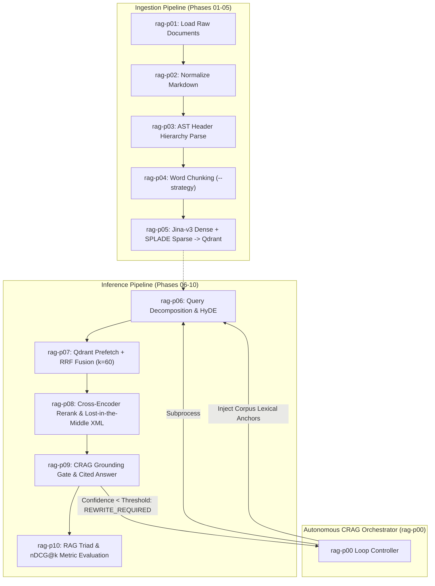
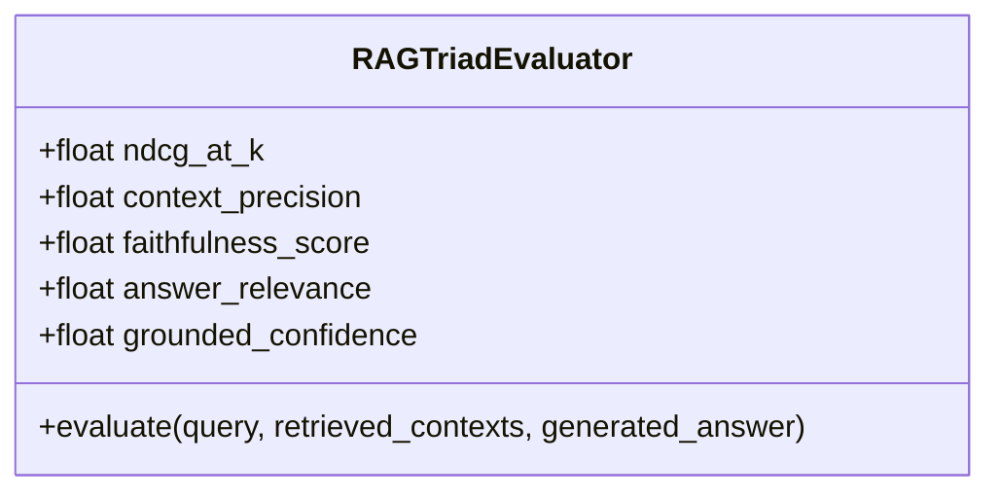

# SOTA Hybrid RAG CLI Pipeline (`sota-hybrid-rag-cli`)

A modular, production-grade 10-phase UNIX-piped Hybrid Retrieval-Augmented Generation (RAG) CLI suite with an autonomous Corrective RAG (CRAG) loop controller (`rag-p00`), built with **FastEmbed**, **Qdrant**, **Jina-v3 dense embeddings**, **SPLADE++ sparse representations**, and **Cross-Encoder reranking**.

---

## Table of Contents

- [Architectural Overview & Tri-Plex I/O Law](#architectural-overview--tri-plex-io-law)
- [System Architecture Flow](#system-architecture-flow)
- [Installation & Environment Setup](#installation--environment-setup)
- [Phase-by-Phase Reference (Phases 01–10 & P00)](#phase-by-phase-reference-phases-0110--p00)
  - [Phase 01: Document Loading (`rag-p01`)](#phase-01-document-loading-rag-p01)
  - [Phase 02: Markdown Normalization (`rag-p02`)](#phase-02-markdown-normalization-rag-p02)
  - [Phase 03: Structural AST Parsing (`rag-p03`)](#phase-03-structural-ast-parsing-rag-p03)
  - [Phase 04: Semantic Chunking (`rag-p04`)](#phase-04-semantic-chunking-rag-p04)
  - [Phase 05: Hybrid Qdrant Indexing (`rag-p05`)](#phase-05-hybrid-qdrant-indexing-rag-p05)
  - [Phase 06: Query Decomposition & HyDE Plan (`rag-p06`)](#phase-06-query-decomposition--hyde-plan-rag-p06)
  - [Phase 07: Hybrid Prefetch + RRF Retrieval (`rag-p07`)](#phase-07-hybrid-prefetch--rrf-retrieval-rag-p07)
  - [Phase 08: Cross-Encoder Reranking & Context Assembly (`rag-p08`)](#phase-08-cross-encoder-reranking--context-assembly-rag-p08)
  - [Phase 09: CRAG Verification & Grounded Generation (`rag-p09`)](#phase-09-crag-verification--grounded-generation-rag-p09)
  - [Phase 10: RAG Triad & nDCG Evaluation (`rag-p10`)](#phase-10-rag-triad--ndcg-evaluation-rag-p10)
  - [Phase 00: Autonomous CRAG Loop Orchestrator (`rag-p00`)](#phase-00-autonomous-crag-loop-orchestrator-rag-p00)
- [Pluggability](#pluggability)
- [Evaluation Metrics Deep Dive](#evaluation-metrics-deep-dive)
  - [Normalized Discounted Cumulative Gain (nDCG@k)](#1-normalized-discounted-cumulative-gain-ndcgk)
  - [Context Precision](#2-context-precision)
  - [Faithfulness Score](#3-faithfulness-score)
  - [Answer Relevance](#4-answer-relevance)
  - [CRAG Grounded Confidence](#5-crag-grounded-confidence)
- [UNIX Piping & Pipeline Recipes](#unix-piping--pipeline-recipes)
  - [Exact Command Sequence: Execution on README.md](#exact-command-sequence-execution-on-readmemd)
  - [Complete 10-Phase End-to-End Pipe](#complete-10-phase-end-to-end-pipe)
  - [Modular Inference Only](#modular-inference-only-re-using-existing-indexed-qdrant-database)
- [Verification & Test Battery](#verification--test-battery)
- [Commit, Push & Pull Request (PR) Guide](#commit-push--pull-request-pr-guide)

---

## Architectural Overview & Tri-Plex I/O Law

Every CLI phase (`rag-p01` through `rag-p10`, plus `rag-p00`) strictly adheres to the **Tri-Plex I/O Law** to enable composability across standard POSIX pipes and PowerShell streams without output corruption:

1. **Standard Output (`stdout`):** Emits **exclusively** raw, valid JSON (`model_dump_json(indent=2)`). Zero logging, zero banners, and zero formatting pollute this stream.
2. **Standard Error (`stderr`):** Emits Rich diagnostic tables, pipeline telemetry panels, timing, and progress indicators via `Console(stderr=True)`.
3. **Deterministic Disk Artifact (`--out-file` / `-o`):** Every phase writes an identical validated JSON artifact to disk (defaulting to `artifacts/0X_<phase_name>.json`).

### Strict Pydantic Contracts

All phase inputs and outputs are validated against strict Pydantic v2 models configured with:
```python
model_config = ConfigDict(strict=True, extra="forbid")
```
This guarantees compile-time schema safety and prevents downstream silent failures from unrecognized or type-mismatched keys.

---

## System Architecture Flow



---

## Installation & Environment Setup

This project uses `uv` for workspace and dependency management:

```bash
# Clone the repository
git clone https://github.com/zautke/phase-rag-cli.git
cd phase-rag-cli

# Synchronize virtual environment with all required models
uv sync --all-extras

# Copy environment template if using custom Qdrant URLs or API keys
cp .env.example .env
```

fastembed models (SPLADE++, the ONNX reranker) use the same Hugging Face cache root as sentence-transformers (`HF_HOME` / `HF_HUB_CACHE`): one persistent cache for every backend. Run with `uv run --env-file .env ...` or export the variables.

Model downloads need **aria2c** on PATH (`winget install aria2.aria2` / `sudo apt-get install -y aria2` / `brew install aria2`). `model_fetch.ensure_model` fetches every model file with aria2c (8 connections, resumable, 10 retries) into the Hugging Face cache layout before a model loads, and prints the repo, each file, live progress and a done line to stderr; the libraries then load from cache and download nothing themselves. Without aria2c, the first phase that needs a missing model exits with `aria2c not found on PATH` and the install hint.

---

## Phase-by-Phase Reference (Phases 01–10 & P00)

### Phase 01: Document Loading (`rag-p01`)
- **CLI Command:** `uv run rag-p01` (or `python p01_load.py`)
- **Input Contract:** Filesystem directory or built-in test corpus
- **Output Contract:** `Phase01LoadedOutput` (`artifacts/01_loaded.json`)
- **Key Flags:**
  - `-s`, `--source-dir`: Path to folder containing `.html`, `.md`, `.txt` documents.
  - `-o`, `--out-file`: Output file path (default: `artifacts/01_loaded.json`).
- **Functionality:** Ingests raw multi-format files or initializes the default high-density architectural corpus (HTML + Markdown covering Hybrid RAG, Late Chunking, and CRAG).
- **Example:**
  ```powershell
  uv run rag-p01 -o artifacts/01_loaded.json
  ```

---

### Phase 02: Markdown Normalization (`rag-p02`)
- **CLI Command:** `uv run rag-p02` (or `python p02_markdown.py`)
- **Input Contract:** `Phase01LoadedOutput`
- **Output Contract:** `Phase02MarkdownOutput` (`artifacts/02_markdown.json`)
- **Key Flags:**
  - `-i`, `--in-file`: Upstream loaded JSON file (or reads stdin).
  - `-o`, `--out-file`: Output file path (default: `artifacts/02_markdown.json`).
- **Functionality:** Strips HTML boilerplate and scripts, converting HTML into clean GFM (GitHub Flavored Markdown) while extracting structural frontmatter metadata.
- **Example:**
  ```powershell
  uv run rag-p02 -i artifacts/01_loaded.json -o artifacts/02_markdown.json
  ```

---

### Phase 03: Structural AST Parsing (`rag-p03`)
- **CLI Command:** `uv run rag-p03` (or `python p03_parse.py`)
- **Input Contract:** `Phase02MarkdownOutput`
- **Output Contract:** `Phase03ParsedOutput` (`artifacts/03_parsed.json`)
- **Key Flags:**
  - `-i`, `--in-file`: Upstream markdown JSON (or reads stdin).
  - `-o`, `--out-file`: Output file path (default: `artifacts/03_parsed.json`).
- **Functionality:** Parses markdown into an Abstract Syntax Tree (AST) using header hierarchy tracking (`# H1` -> `## H2` -> `### H3`), emitting discrete structural sections with contextual breadcrumbs (`header_path: ["Hybrid RAG Architecture", "Late Chunking"]`).
- **Example:**
  ```powershell
  uv run rag-p03 -i artifacts/02_markdown.json -o artifacts/03_parsed.json
  ```

---

### Phase 04: Semantic Chunking (`rag-p04`)
- **CLI Command:** `uv run rag-p04` (or `python p04_chunk.py`)
- **Input Contract:** `Phase03ParsedOutput`
- **Output Contract:** `Phase04ChunkedOutput` (`artifacts/04_chunked.json`)
- **Key Flags:**
  - `-i`, `--in-file`: Upstream parsed sections.
  - `-o`, `--out-file`: Output file path (default: `artifacts/04_chunked.json`).
  - `-m`, `--max-words`: Chunk size in words (default: `60`, minimum `1`).
  - `-v`, `--overlap`: Word overlap between adjacent chunks (default: `12`; ignored by `recursive`).
  - `-s`, `--strategy`: Chunker name, `sliding_window` (default) or `recursive` (paragraph, then sentence, then word window). Unknown names exit 2 with the known names on stderr. See [Pluggability](#pluggability).
- **Functionality:** Performs deterministic word chunking with a pluggable strategy (`sliding_window` default, or `recursive`) while preserving the full section `parent_markdown` reference for contextual expansion.
- **Example:**
  ```powershell
  uv run rag-p04 -i artifacts/03_parsed.json -o artifacts/04_chunked.json --max-words 50 --overlap 10
  ```

---

### Phase 05: Hybrid Qdrant Indexing (`rag-p05`)
- **CLI Command:** `uv run rag-p05` (or `python p05_index.py`)
- **Input Contract:** `Phase04ChunkedOutput`
- **Output Contract:** `Phase05IndexedOutput` (`artifacts/05_indexed.json`)
- **Key Flags:**
  - `-i`, `--in-file`: Upstream chunked JSON.
  - `-o`, `--out-file`: Output file path (default: `artifacts/05_indexed.json`).
  - `-c`, `--collection`: Qdrant collection name (default: `hybrid_rag_corpus`).
  - `-p`, `--qdrant-path`: Local Qdrant embedded storage directory (default: `./qdrant_storage`).
  - `-u`, `--qdrant-url`: Remote Qdrant server URL (e.g., `http://localhost:6333`).
  - `-b`, `--batch-size`: Batch size for dense/sparse embedding (default: `32`).
- **Functionality:**
  1. Prepends contextual headers: `[Doc: <id> | Section: <path>] <chunk_text>`.
  2. Dense vector embedding: **Jina-v3** (`jinaai/jina-embeddings-v3`, 1024-dimensional) with INT8 scalar quantization.
  3. Sparse lexical embedding: **SPLADE++** (`prithivida/Splade_PP_en_v1`) generating high-dimensional bag-of-words weights.
  4. Upserts points using deterministic UUIDv5 IDs derived from `doc_id + chunk_id`.
  5. Closes Qdrant client connection cleanly to prevent lock contention.
- **Example:**
  ```powershell
  uv run rag-p05 -i artifacts/04_chunked.json -o artifacts/05_indexed.json --collection hybrid_rag_corpus
  ```

---

### Phase 06: Query Decomposition & HyDE Plan (`rag-p06`)
- **CLI Command:** `uv run rag-p06` (or `python p06_query.py`)
- **Input Contract:** `Phase05IndexedOutput` (or standalone with query)
- **Output Contract:** `Phase06QueryPlanOutput` (`artifacts/06_query_plan.json`)
- **Key Flags:**
  - `-q`, `--query`: Natural language user question.
  - `-i`, `--in-file`: Upstream indexed payload.
  - `-o`, `--out-file`: Output file path (default: `artifacts/06_query_plan.json`).
- **Functionality:** Decomposes complex multi-clause queries into independent sub-queries, classifies query intent, and synthesizes a Hypothetical Document Embedding (HyDE) passage to guide semantic retrieval.
- **Example:**
  ```powershell
  uv run rag-p06 -i artifacts/05_indexed.json -o artifacts/06_query_plan.json --query "How does Qdrant fuse dense and sparse vectors?"
  ```

---

### Phase 07: Hybrid Prefetch + RRF Retrieval (`rag-p07`)
- **CLI Command:** `uv run rag-p07` (or `python p07_retrieve.py`)
- **Input Contract:** `Phase06QueryPlanOutput`
- **Output Contract:** `Phase07RetrievedOutput` (`artifacts/07_retrieved.json`)
- **Key Flags:**
  - `-i`, `--in-file`: Upstream query plan.
  - `-o`, `--out-file`: Output file path (default: `artifacts/07_retrieved.json`).
  - `-k`, `--top-k`: Number of candidate passages to retrieve (default: `10`).
  - `-r`, `--rrf-k`: Reciprocal Rank Fusion constant $k$ (default: `60`).
  - `-d`, `--dense-weight`: RRF weight for dense branch (default: `1.0`).
  - `-s`, `--sparse-weight`: RRF weight for sparse branch (default: `1.0`).
- **Functionality:**
  - Encodes query + HyDE for 1024-d dense retrieval branch.
  - Encodes raw query terms for SPLADE sparse lexical branch.
  - Issues a single Qdrant Universal Query using dual `Prefetch` clauses combined via `models.RrfQuery(rrf=models.Rrf(k=rrf_k, weights=[dense_weight, sparse_weight]))`.
- **Example:**
  ```powershell
  uv run rag-p07 -i artifacts/06_query_plan.json -o artifacts/07_retrieved.json --top-k 8 --rrf-k 60
  ```

---

### Phase 08: Cross-Encoder Reranking & Context Assembly (`rag-p08`)
- **CLI Command:** `uv run rag-p08` (or `python p08_rerank.py`)
- **Input Contract:** `Phase07RetrievedOutput`
- **Output Contract:** `Phase08RerankedOutput` (`artifacts/08_reranked.json`)
- **Key Flags:**
  - `-i`, `--in-file`: Upstream retrieved candidates.
  - `-o`, `--out-file`: Output file path (default: `artifacts/08_reranked.json`).
  - `-n`, `--top-n`: Number of reranked candidates to retain (default: `5`).
  - `-b`, `--backend`: Reranker backend: `fastembed` or `transformers` (default: `fastembed`).
  - `-m`, `--model`: Cross-Encoder model (default: `jinaai/jina-reranker-v2-base-multilingual`).
- **Functionality:**
  1. Scores `(query, passage)` pairs with a Cross-Encoder to compute continuous logits.
  2. Applies sigmoid normalization to produce calibrated $[0.0, 1.0]$ confidence scores.
  3. Deduplicates redundant chunks sharing the same `parent_markdown` block.
  4. Assembles `<retrieved_context>` XML using **Lost-in-the-Middle** ordering: the top-scoring passage is placed at index 0 (top of prompt), the second-highest at the bottom of the prompt, and lower-scoring candidates in the middle to optimize LLM attention dynamics.
- **Example:**
  ```powershell
  uv run rag-p08 -i artifacts/07_retrieved.json -o artifacts/08_reranked.json --top-n 4
  ```

---

### Phase 09: CRAG Verification & Grounded Generation (`rag-p09`)
- **CLI Command:** `uv run rag-p09` (or `python p09_generate.py`)
- **Input Contract:** `Phase08RerankedOutput`
- **Output Contract:** `Phase09GenerationOutput` (`artifacts/09_generated.json`)
- **Key Flags:**
  - `-i`, `--in-file`: Upstream reranked context.
  - `-o`, `--out-file`: Output file path (default: `artifacts/09_generated.json`).
  - `-t`, `--crag-threshold`: Corrective RAG confidence threshold (default: `0.65`).
- **Functionality:**
  - Inspects `max(cross_encoder_score)` against `--crag-threshold`.
  - If $\ge \text{threshold}$: emits `crag_verdict = "GROUNDED"` and synthesizes an answer grounded strictly in `<retrieved_context>` with inline citations (`[doc_id:chunk_id]`).
  - If $< \text{threshold}$: emits `crag_verdict = "REWRITE_REQUIRED"`, signalling downstream/orchestrator loop intervention.
- **Example:**
  ```powershell
  uv run rag-p09 -i artifacts/08_reranked.json -o artifacts/09_generated.json --crag-threshold 0.65
  ```

---

### Phase 10: RAG Triad & nDCG Evaluation (`rag-p10`)
- **CLI Command:** `uv run rag-p10` (or `python p10_evaluate.py`)
- **Input Contract:** `Phase09GenerationOutput`
- **Output Contract:** `Phase10EvalOutput` (`artifacts/10_evaluated.json`)
- **Key Flags:**
  - `-i`, `--in-file`: Upstream generated output.
  - `-o`, `--out-file`: Output file path (default: `artifacts/10_evaluated.json`).
- **Functionality:** Evaluates end-to-end RAG quality using quantitative metrics: `ndcg_at_k`, `context_precision`, `faithfulness_score`, and `answer_relevance`.
- **Example:**
  ```powershell
  uv run rag-p10 -i artifacts/09_generated.json -o artifacts/10_evaluated.json
  ```

---

### Phase 00: Autonomous CRAG Loop Orchestrator (`rag-p00`)
- **CLI Command:** `uv run rag-p00` (or `python p00_crag_orchestrator.py`)
- **Input Contract:** `Phase05IndexedOutput` (or standalone with `--query`)
- **Output Contract:** `PhaseCRAGLoopOutput` (`artifacts/00_crag_loop_summary.json`)
- **Key Flags:**
  - `-q`, `--query`: Natural language query.
  - `-i`, `--in-file`: Upstream indexed payload.
  - `-o`, `--out-file`: Output summary path (default: `artifacts/00_crag_loop_summary.json`).
  - `-t`, `--crag-threshold`: Confidence threshold (default: `0.65`).
  - `-r`, `--max-retries`: Total CRAG attempts (default: `3`).
  - `-l`, `--prefetch-limit` (25), `-k`, `--rrf-k` (60), `-K`, `--top-k` (10): forwarded to `rag-p07` on every attempt.
  - `-n`, `--top-n` (5), `-B`, `--batch-size` (16): forwarded to `rag-p08` on every attempt.
  - `-c`, `--quiet-children`: Suppress child phase telemetry to keep stderr clean.
- **Functionality:**
  1. Executes child pipeline phases `P06 -> P07 -> P08 -> P09` as isolated subprocesses.
  2. If `crag_verdict == "REWRITE_REQUIRED"`:
     - Extracts informative corpus-grounded anchor tokens from the retrieved candidate chunks.
     - Rewrites the user query incorporating high-discriminative domain terms.
     - Isolates artifacts for that cycle under `artifacts/crag_attempt_<attempt>/`.
     - Re-executes the retrieval cycle up to `--max-retries`.
  3. Finalizes by invoking `P10` for metric evaluation, writing a consolidated convergence log to `artifacts/00_crag_loop_summary.json`.
- **Example:**
  ```powershell
  uv run rag-p00 --query "How does Late Chunking work?" --crag-threshold 0.65 --max-retries 2
  ```

---

## Pluggability

Every phase reads one strict JSON contract on stdin and writes the next on stdout, so swapping or adding a stage needs no framework.

- **Chunking strategy.** `rag-p04 --strategy NAME` picks a chunker from the registry in `chunkers.py` (`sliding_window`, `recursive`). The chosen name is recorded in `Phase04ChunkedOutput.chunk_strategy`. Artifacts written before this field existed still validate (default `sliding_window`). To add a chunker, write a `(section, max_words, overlap) -> list[DocumentChunk]` function and register it in `CHUNKERS`. Chunk ids must be unique per section, because they derive the Qdrant point ids.
- **External stage drop-in via pipe.** Any program that reads `Phase04ChunkedOutput` JSON on stdin and writes the same schema on stdout can sit between `rag-p04` and `rag-p05`. Nothing else changes.
- **Contract change.** `Phase06QueryPlanOutput` carries `qdrant_collection` instead of the full P05 payload, so P06 output no longer embeds indexed records. Older 06/07 artifacts with `index_snapshot` are rejected; regenerate them.

---

## Evaluation Metrics Deep Dive
Phase 10 (`rag-p10`) implements the **RAG Triad** framework supplemented by **nDCG@k** to provide objective verification of retrieval fidelity and generator alignment:



### 1. Normalized Discounted Cumulative Gain (nDCG@k)
- **Purpose:** Measures the ranking quality of the prompt's `<retrieved_context>` XML block against ideal Cross-Encoder relevance ordering.
- **Mathematical Formula:**
  $$\text{DCG}@k = \sum_{i=1}^{k} \frac{rel_i}{\log_2(i + 1)}$$
  $$\text{nDCG}@k = \frac{\text{DCG}@k}{\text{IDCG}@k}$$
  Where $rel_i \in [0.0, 1.0]$ is the normalized Cross-Encoder score of the passage placed at rank $i$, and $\text{IDCG}@k$ is the maximum possible DCG obtained by sorting passages strictly in descending order of relevance.
- **Significance:** Because Phase 08 applies **Lost-in-the-Middle** positioning (placing the #1 passage at the top and #2 at the bottom to counter LLM attention degradation in mid-context), `ndcg_at_k` quantifies the trade-off between attention bias optimization and strict descending relevance.

### 2. Context Precision
- **Purpose:** Measures the signal-to-noise ratio of the retrieved candidate pool.
- **Mathematical Formula:**
  $$\text{Context Precision} = \frac{|\{c \in \text{Retrieved Contexts} \mid \text{score}(c) \ge \tau\}|}{|\text{Retrieved Contexts}|}$$
  Where $\tau$ is the relevance threshold (default: $0.30$).
- **Significance:** Penalizes retrieval runs that clutter the LLM context window with irrelevant or low-scoring passages.

### 3. Faithfulness Score
- **Purpose:** Quantifies whether the generated answer is strictly grounded in the retrieved context (hallucination detection).
- **Mathematical Formula:**
  $$\text{Faithfulness} = \frac{|\text{Tokens}(\text{Answer}) \cap \text{Tokens}(\text{Retrieved Context})|}{|\text{Tokens}(\text{Answer})|}$$
- **Significance:** Ensures the model does not fabricate facts or entities absent from the retrieved passages. A score approaching $1.0$ indicates that claims are fully supported by context citations.

### 4. Answer Relevance
- **Purpose:** Measures whether the generated answer directly addresses the intent of the original query.
- **Mathematical Formula:**
  $$\text{Answer Relevance} = \frac{|\text{Tokens}(\text{Query}) \cap \text{Tokens}(\text{Answer})|}{|\text{Tokens}(\text{Query})|}$$
- **Significance:** Prevents evasive or off-topic responses that remain faithful to irrelevant retrieved text without answering the user's question.

### 5. CRAG Grounded Confidence
- **Purpose:** Calibrated decision boundary for triggering query rewrites in Phase 09 and Phase 00.
- **Definition:**
  $$\text{Grounded Confidence} = \max_{c \in \text{Contexts}} (\text{CrossEncoderScore}(c))$$
  - $\ge 0.65$: High confidence -> **`GROUNDED`** (proceed to synthesize answer).
  - $< 0.65$: Low confidence -> **`REWRITE_REQUIRED`** (trigger query rewrite loop).

---

## UNIX Piping & Pipeline Recipes

The pipeline supports full zero-copy linear piping from ingestion to evaluation, as well as step-by-step isolated phase execution.

### Exact Command Sequence: Execution on README.md

To index `README.md`, formulate a query about Phase 08 Lost-in-the-Middle context assembly and Phase 10 eval metrics, and execute all 10 phases with complete artifact persistence, run the following command sequence:

#### Option A: Step-by-Step Isolated Phase CLI Execution (PowerShell / Bash)
```powershell
# 1. Prepare artifact and storage directories
mkdir -p artifacts/readme_run

# 2. Phase 01: Ingest README.md
uv run rag-p01 -s README.md -o artifacts/readme_run/01_loaded.json

# 3. Phase 02: Normalize Markdown & frontmatter
uv run rag-p02 -i artifacts/readme_run/01_loaded.json -o artifacts/readme_run/02_markdown.json

# 4. Phase 03: Structural AST Header hierarchy parsing
uv run rag-p03 -i artifacts/readme_run/02_markdown.json -o artifacts/readme_run/03_parsed.json

# 5. Phase 04: Semantic chunking (sliding-window by default)
uv run rag-p04 -i artifacts/readme_run/03_parsed.json -o artifacts/readme_run/04_chunked.json --max-words 80 --overlap 15

# 6. Phase 05: Dense (Jina-v3) + Sparse (SPLADE) indexing into Qdrant
uv run rag-p05 -i artifacts/readme_run/04_chunked.json -o artifacts/readme_run/05_indexed.json --collection readme_corpus --qdrant-path ./qdrant_readme

# 7. Phase 06: Query decomposition & HyDE passage synthesis
uv run rag-p06 -i artifacts/readme_run/05_indexed.json -o artifacts/readme_run/06_query_plan.json --query "How does Phase 08 Cross-Encoder reranking implement Lost-in-the-Middle context assembly and what eval metrics are computed in Phase 10?"

# 8. Phase 07: Hybrid Prefetch + RRF Retrieval (k=60)
uv run rag-p07 -i artifacts/readme_run/06_query_plan.json -o artifacts/readme_run/07_retrieved.json --qdrant-path ./qdrant_readme --top-k 6 --rrf-k 60

# 9. Phase 08: Cross-Encoder reranking & Lost-in-the-Middle XML context assembly
uv run rag-p08 -i artifacts/readme_run/07_retrieved.json -o artifacts/readme_run/08_reranked.json --backend fastembed --model jinaai/jina-reranker-v2-base-multilingual --top-n 4

# 10. Phase 09: CRAG Grounding gate & cited answer generation
uv run rag-p09 -i artifacts/readme_run/08_reranked.json -o artifacts/readme_run/09_generated.json --crag-threshold 0.50

# 11. Phase 10: RAG Triad & nDCG metric evaluation
uv run rag-p10 -i artifacts/readme_run/09_generated.json -o artifacts/readme_run/10_evaluated.json
```

#### Option B: Full Zero-Copy UNIX Pipe Execution
```bash
uv run rag-p01 -s README.md | \
uv run rag-p02 | \
uv run rag-p03 | \
uv run rag-p04 --max-words 80 --overlap 15 | \
uv run rag-p05 --collection readme_corpus --qdrant-path ./qdrant_readme | \
uv run rag-p06 --query "How does Phase 08 Cross-Encoder reranking implement Lost-in-the-Middle context assembly and what eval metrics are computed in Phase 10?" | \
uv run rag-p07 --qdrant-path ./qdrant_readme --top-k 6 --rrf-k 60 | \
uv run rag-p08 --backend fastembed --top-n 4 | \
uv run rag-p09 --crag-threshold 0.50 | \
uv run rag-p10 > artifacts/readme_run/10_evaluated.json
```

#### Option C: Automated Python Demonstration Runner
To execute all 10 stages sequentially and display the formatted generation payload and evaluation table:
```bash
uv run python run_readme_pipeline.py
```

---

### Complete 10-Phase End-to-End Pipe
```bash
# Linear pipeline from document loading to evaluation:
uv run rag-p01 | \
uv run rag-p02 | \
uv run rag-p03 | \
uv run rag-p04 --max-words 50 --overlap 10 | \
uv run rag-p05 --collection demo_corpus | \
uv run rag-p06 --query "How does Qdrant fuse Jina-v3 dense and SPLADE sparse vectors?" | \
uv run rag-p07 --top-k 6 --rrf-k 60 | \
uv run rag-p08 --top-n 4 --backend fastembed | \
uv run rag-p09 --crag-threshold 0.50 | \
uv run rag-p10 > artifacts/final_eval.json
```

### Modular Inference Only (Re-using Existing Indexed Qdrant Database)
```bash
# Execute retrieval and generation against an existing collection:
uv run rag-p06 --in-file artifacts/05_indexed.json --query "What is Late Chunking?" | \
uv run rag-p07 --qdrant-path ./qdrant_storage --top-k 5 | \
uv run rag-p08 --backend fastembed --top-n 3 | \
uv run rag-p09 --crag-threshold 0.60 | \
uv run rag-p10
```

---

## Verification & Test Battery

The repository includes a comprehensive 4-stage automated verification battery that exercises the static contracts, per-phase isolation, UNIX pipe integrity, and autonomous CRAG loopback convergence.

Both batteries check every phase's exit code (stderr tail on failure), check all ten pipe stages, assert that `rag-p00` converges `GROUNDED` at its defaults, and write a full transcript to `artifacts/verify_<ps1|sh>_<timestamp>.log`. Switches: `-s/--skip-sync`, `-q/--quiet`, `-h/--help`.

### Running on Windows (PowerShell 7+)
```powershell
pwsh -File .\verify_pipeline.ps1 [-s] [-q]
```

### Running on POSIX (Linux / macOS)
```bash
./verify_pipeline.sh [-s] [-q]
```

### Running the bash battery from Windows (WSL, real Linux)
```powershell
wsl -d Ubuntu-24.04 --exec bash -lc "export PATH=`$HOME/.local/bin:`$PATH UV_PROJECT_ENVIRONMENT=`$HOME/.venvs/phase-rag HF_HUB_DISABLE_XET=1; cd /mnt/c/<path-to-repo> && uv sync --all-extras && ./verify_pipeline.sh -s"
```
Use `--exec` (plain `--` fails on a Windows PATH containing `(x86)`), a Linux `UV_PROJECT_ENVIRONMENT` (the Windows `.venv` is unusable from Linux), aria2c installed in the distro (`sudo apt-get install -y aria2`), and `HF_HUB_DISABLE_XET=1` as a belt-and-braces guard (aria2c now does the model downloads, so the HuggingFace Xet path is not used).

### Verification Stages
- **Stage 0:** UV sync & AST static review (verifies 0 stdout `print()` calls across all 13 scripts, strictly continuous type contracts across Phase 01–10, and explicit `client.close()` calls).
- **Stage 1:** In-terminal step-by-step isolated phase tests (`rag-p01` through `rag-p10`) with disk and stdout parity checks.
- **Stage 2:** Full 10-phase zero-copy UNIX pipe through-test.
- **Stage 3:** Autonomous CRAG loopback query-rewrite test (`rag-p00` forcing rewrite at threshold 0.92).

### Running Unit & Integration Tests
```powershell
uv run pytest -v
uv run ruff check .
```

---

## Commit, Push & Pull Request (PR) Guide

Follow these steps to contribute or sync your changes with GitHub:

### 1. Check Working Tree & Status
```powershell
git status
```

### 2. Stage & Commit Changes
```powershell
git add README.md
git commit -m "docs: add comprehensive phase reference, evaluation metric analysis, and PR workflow"
```

### 3. Push Feature Branch to GitHub
```powershell
git push -u origin feat/hybrid-rag-cli
```

### 4. Create Pull Request (via GitHub CLI)
```powershell
gh pr create --base development --head feat/hybrid-rag-cli --title "feat: SOTA 10-Phase Hybrid RAG CLI Suite & CRAG Loop Controller" --body "## Summary
Implements 10-phase UNIX-piped Hybrid RAG CLI suite + P00 CRAG Loop Controller with Pydantic v2 Tri-Plex I/O, Qdrant RRF (Jina-v3 dense + SPLADE sparse), Cross-Encoder reranking, and full test battery.

- 10 CLI Phase entrypoints (p01_load.py .. p10_evaluate.py)
- P00 Autonomous CRAG loopback controller
- Strict Pydantic contracts (extra='forbid')
- verify_pipeline.ps1 & verify_pipeline.sh verified passing
- 16/16 integration and unit tests passing in pytest"
```
Or open a PR manually in your browser at:
`https://github.com/zautke/phase-rag-cli/compare/development...feat/hybrid-rag-cli`
