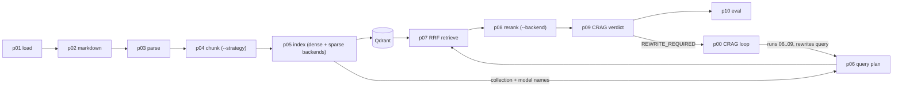

# SOTA Hybrid RAG CLI Pipeline (`sota-hybrid-rag-cli`)

A 10-phase UNIX-piped Hybrid Retrieval-Augmented Generation (RAG) CLI suite with an autonomous Corrective RAG (CRAG) loop controller (`rag-p00`). Dense and sparse embedders and the cross-encoder reranker are named backend plugins (defaults: sentence-transformers Jina-v3 dense, fastembed SPLADE++ sparse, sentence-transformers BGE reranker), fused by Qdrant Reciprocal Rank Fusion (RRF).

Full reference: [`docs/MASTER_MANUAL.md`](docs/MASTER_MANUAL.md). Release notes: [`CHANGELOG.md`](CHANGELOG.md). Interface UML: [`docs/architecture/PLUGGABLE_INTERFACE_UML.md`](docs/architecture/PLUGGABLE_INTERFACE_UML.md).

## The law every phase obeys

1. **stdout**: exactly one `model_dump_json(indent=2)` payload, nothing else.
2. **stderr**: Rich panels, telemetry and model-download progress (`Console(stderr=True)`).
3. **disk**: the same JSON in `--out-file` (default `artifacts/NN_*.json`).
4. **Strict contracts**: every payload is a Pydantic model with `ConfigDict(strict=True, extra="forbid")`; phase N validates phase N-1's output through `PhaseCLI.load_upstream()`.
5. **CLI**: every option has a short `-x` and a long `--full-name` switch, no positional arguments, `Usage()` is the `--help` epilog.



## Install

```bash
git clone https://github.com/zautke/phase-rag-cli.git && cd phase-rag-cli
uv sync --all-extras          # never bare `uv sync`: it drops the dev extra (pytest, ruff)
cp .env.example .env          # defaults for QDRANT_*, RAG_* (see below)
```

- Requires **aria2c** on PATH (`winget install aria2.aria2` / `sudo apt-get install -y aria2` / `brew install aria2`). `model_fetch.ensure_model` downloads every model file with aria2c (8 connections, resumable, retries) into the Hugging Face cache layout and prints the repo, each file and live progress to stderr; the libraries then load from cache and never download on their own. Without aria2c the first phase that needs a model exits with `aria2c not found on PATH` and the install hint.
- fastembed and sentence-transformers share one cache (`HF_HOME` / `HF_HUB_CACHE`). Run with `uv run --env-file .env ...` or export the variables.
- First run downloads Jina-v3 (~2.3 GB), SPLADE++ and the reranker.
- Qdrant is embedded at `./qdrant_storage` (one process at a time); set `QDRANT_URL` / `--qdrant-url` for a server.

## Configuration (`.env.example` is the single source of defaults)

| Key | Default | Read by |
|---|---|---|
| `QDRANT_URL` | empty (embedded) | p05, p07, p00 |
| `QDRANT_PATH` | `./qdrant_storage` | p05, p07, p00 |
| `RAG_CRAG_THRESHOLD` | `0.65` | p09, p00 |
| `RAG_DENSE_BACKEND` | `sentence_transformers` | p05 |
| `RAG_DENSE_MODEL` | `jinaai/jina-embeddings-v3` | p05 |
| `RAG_SPARSE_MODEL` | `prithivida/Splade_PP_en_v1` | p05 |

## Phases

All phases take `-i/--in-file` (else stdin), `-o/--out-file` and a quiet switch (`-q`; `-s` on p06/p00). Run `uv run rag-pNN --help` for the exact table.

| Phase | Reads -> writes | Key options |
|---|---|---|
| `rag-p01` | none -> `Phase01LoadedOutput` | `-s/--source-dir` (file or folder; default built-in corpus) |
| `rag-p02` | 01 -> `Phase02MarkdownOutput` | HTML to Markdown |
| `rag-p03` | 02 -> `Phase03ParsedOutput` | header-path AST sections |
| `rag-p04` | 03 -> `Phase04ChunkedOutput` | `-m/--max-words` (60), `-v/--overlap` (12; `>= 0` and `< --max-words`, else exit 2), `-s/--strategy` (`sliding_window` \| `recursive`) |
| `rag-p05` | 04 -> `Phase05IndexedOutput` | `-c/--collection`, `-u/--qdrant-url`, `-p/--qdrant-path`, `-b/--dense-backend`, `-m/--dense-model`, `-s/--sparse-model`, `-r/--recreate` \| `-a/--append` |
| `rag-p06` | 05 -> `Phase06QueryPlanOutput` | `-q/--query`; carries collection and model names from p05 |
| `rag-p07` | 06 -> `Phase07RetrievedOutput` | `-l/--prefetch-limit` (25), `-k/--rrf-k` (60), `-d/--dense-weight`, `-s/--sparse-weight`, `-t/--top-k` (10), `-u`, `-p` |
| `rag-p08` | 07 -> `Phase08RerankedOutput` | `-b/--backend` (`sentence_transformers` \| `fastembed`), `-m/--model`, `-s/--batch-size` (16), `-n/--top-n` (5) |
| `rag-p09` | 08 -> `Phase09GenerationOutput` | `-t/--crag-threshold` (0.65) |
| `rag-p10` | 09 -> `Phase10EvalOutput` | RAG Triad + nDCG |
| `rag-p00` | 05 -> `PhaseCRAGLoopOutput` | `-r/--max-retries` (retries after the first attempt, default 2), `-t/--crag-threshold`, `-b/--rerank-backend`, `-m/--rerank-model`, forwarded p07/p08 knobs |

`rag-p00` runs p06 -> p09 as subprocesses; on `REWRITE_REQUIRED` it rewrites the query with anchor terms that exist in the retrieved corpus, stops when anchors are exhausted or retries run out, then runs p10. Child stderr is inherited, so progress is live.

## Pipe recipes

```bash
# Full pipe (PowerShell 7.4+ and bash both work; use `set -o pipefail` in bash)
uv run rag-p01 | uv run rag-p02 | uv run rag-p03 | uv run rag-p04 -m 50 -v 10 \
  | uv run rag-p05 -c demo_corpus \
  | uv run rag-p06 -q "How does Qdrant fuse dense and sparse vectors?" \
  | uv run rag-p07 -t 6 | uv run rag-p08 -n 4 | uv run rag-p09 -t 0.50 | uv run rag-p10 > artifacts/final_eval.json

# Re-query an existing index (no re-embedding of the corpus)
uv run rag-p06 -i artifacts/05_indexed.json -q "What is Late Chunking?" | uv run rag-p07 | uv run rag-p08 | uv run rag-p09 | uv run rag-p10

# CRAG loop against the existing index
uv run rag-p00 -i artifacts/05_indexed.json -q "How are vectors combined and when does it retry?"
```

## Plugin seams

There are four seams. Each is a name, a registry and a CLI switch; none needs a framework.

| # | Seam | Select with | Registry / contract | Built in |
|---|---|---|---|---|
| 1 | External pipe stage | place it in the pipe | any executable: reads Phase N-1 JSON on stdin, writes Phase N JSON on stdout | none needed |
| 2 | Chunking strategy | `rag-p04 -s NAME` | `CHUNKERS` in `chunkers.py`: `(section, max_words, overlap) -> list[DocumentChunk]` | `sliding_window`, `recursive` |
| 3 | Dense embedder | `rag-p05 -b NAME -m MODEL` | `DENSE_BACKENDS` in `hybrid_engine.py`: `loader(model) -> (embed(texts, query) -> vectors, size)` | `sentence_transformers` (default), `fastembed` |
| 4 | Reranker | `rag-p08 -b NAME -m MODEL` | `RERANK_BACKENDS`: `scorer(query, passages, model, batch_size) -> scores in [0, 1]` | `sentence_transformers` (default), `fastembed` |

The sparse embedder is a registry too (`SPARSE_BACKENDS`: `loader(model) -> embed(texts) -> [(indices, values)]`, built in: `fastembed`). Its model is chosen with `rag-p05 -s/--sparse-model`; the registry holds one backend today, so no `--sparse-backend` switch exists yet.

**Models travel with the index.** p05 records `dense_backend`, `dense_model` and `sparse_model` in `Phase05IndexedOutput`; p06 copies them into `Phase06QueryPlanOutput`; p07 embeds the query with exactly those. A query can never be encoded with a different model than the corpus, and there is no override flag. Changing any of the three means re-running `rag-p05` (the collection is recreated by default).

**Add an external stage (seam 1).** Read the previous phase's JSON from stdin (or `--in-file`), validate it against the published model (`from rag_contracts import Phase04ChunkedOutput`), log only to stderr, write the next phase's JSON to stdout and `--out-file`, exit non-zero on failure. Then `rag-p03 | my-chunker | rag-p05` works unchanged.

**Add a chunker (seam 2).** Write the function, register it, add a case to `tests/test_chunkers.py`:

```python
CHUNKERS["sentences"] = chunk_sentences   # chunkers.py; ids must be unique per run (they derive Qdrant point ids)
```

**Add a dense, sparse or rerank backend (seams 3-4).** Write the loader/scorer in `hybrid_engine.py`, fetch weights through `prefetch_st` / `prefetch_fastembed` (or `ensure_model`) so downloads stay announced and resumable, and add one line to the registry:

```python
DENSE_BACKENDS["my_backend"] = _dense_my_backend      # then: rag-p05 -b my_backend -m org/model
```

An unknown name exits 2 with `Known: ...` on stderr and an empty stdout. Rerank scores must be monotonic in the raw score and clipped to `[0, 1]`. Add a field to a payload only with a default so earlier artifacts still validate. Details and signatures: Master Manual section 7.

## Verification

```powershell
uv run pytest -q          # non-live tests (the `live` marker, which loads real models, is excluded by default)
uv run ruff check .
pwsh -File .\verify_pipeline.ps1 [-s] [-q]      # live battery, Windows
./verify_pipeline.sh [-s] [-q]                  # live battery, Linux/macOS
```

Both wrappers call the single core `verify_pipeline.py`: Stage 0 static audit (no stdout `print()`, strict schemas, contract chain), Stage 1 each phase isolated (exit, stderr, artifact, stdout == disk) plus declared negatives, Stage 2 the full 10-phase pipe, Stage 3 the CRAG loop (must not converge at `--crag-threshold 0.92`; must go `REWRITE_REQUIRED` then `GROUNDED` at defaults). Transcripts land in `verify_logs/` (gitignored). On a Windows host run the bash battery on real Linux:

```powershell
wsl -d Ubuntu-24.04 --exec bash -lc "export PATH=`$HOME/.local/bin:`$PATH UV_PROJECT_ENVIRONMENT=`$HOME/.venvs/phase-rag; cd /mnt/c/<path-to-repo> && uv sync --all-extras && ./verify_pipeline.sh -s"
```

Use `--exec` (plain `--` fails on a PATH containing `(x86)`) and a Linux `UV_PROJECT_ENVIRONMENT` (the Windows `.venv` is unusable from Linux). CI (`.github/workflows/ci.yml`) runs `ruff check` and the non-live pytest suite on every pull request and push; it downloads no models.

## Branches and versions

Feature work branches from `development` and returns by pull request; `main` receives only verified `development`. Both release branches carry a plain `MAJOR.MINOR.PATCH` version (MINOR + 1 into `development`, MAJOR + 1 into `main`); release notes live only in `CHANGELOG.md`.
