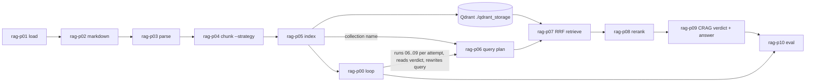

# phase-rag-cli — Master Manual

Complete instruction manual for the 10-phase UNIX-piped Hybrid RAG CLI suite, its CRAG loop controller, and the pluggability layer. Written for an agent or engineer who has never seen the repo. Source of truth: the code on branch `feat/minimal-pluggability` (package `sota-hybrid-rag-cli`; the `0.2.0` bump is the last commit on that branch). Every signature, flag, default, regex and formula below was copied from the code and checked by two independent reviewers on 2026-11-02.

Terms: **RAG** Retrieval-Augmented Generation. **CRAG** Corrective RAG (verdict gate + query rewrite). **HyDE** Hypothetical Document Embeddings (embed a synthetic answer alongside the query). **SPLADE** Sparse Lexical and Expansion model (learned sparse vectors). **RRF** Reciprocal Rank Fusion. **LITM** Lost-in-the-Middle ordering. **Tri-Plex I/O** the stdout/stderr/disk law in §2.1.

## Contents
1. Architecture in one paragraph
2. Quick start (Windows + Linux)
3. The three laws every phase obeys
4. Engine: `rag_contracts.py`
5. Neural engine: `hybrid_engine.py`
6. Phase-by-phase manual (P01 … P10, P00)
7. Pluggability contract (chunker, new field)
8. Debugging a failed pipe
9. Verification
10. File map
11. Invariants an agent must never break
Appendix A. Deferred by design

---

## 1. Architecture in one paragraph

Ten standalone command-line programs (`rag-p01` … `rag-p10`) and one loop controller (`rag-p00`). Each program reads one JSON document on stdin (or `--in-file`), validates it against the previous phase's strict Pydantic model, does one job, and writes one JSON document to stdout for the next program. Composition is the UNIX pipe. Phases 01-05 ingest and index a corpus into Qdrant (hybrid dense Jina-v3 + sparse SPLADE). **P05 → P06 carries only the collection name; the chunks reach P07 through Qdrant, not through the pipe.** Phases 06-10 plan a query, retrieve with RRF, cross-encoder rerank, generate an extractive grounded answer with a CRAG verdict, and score it. `rag-p00` runs 06→09 as subprocesses in a loop, reads P09's verdict, rewrites the query until `GROUNDED` or attempts are exhausted, then runs P10.



---

## 2. Quick start

```powershell
# Windows, pwsh 7.4+ (host has 7.6.7): native uv→uv pipes preserve bytes
uv sync --all-extras                     # never bare `uv sync`: it removes the dev extra (pytest, ruff)
uv run rag-p01 | uv run rag-p02 | uv run rag-p03 | uv run rag-p04 -s recursive | uv run rag-p05 | uv run rag-p06 -q "your question" | uv run rag-p07 | uv run rag-p08 | uv run rag-p09 | uv run rag-p10
uv run rag-p00 -i artifacts/05_indexed.json -q "your question" -t 0.92      # CRAG loop against the existing index
```
```bash
# Linux/macOS
uv sync --all-extras
set -o pipefail
uv run rag-p01 | uv run rag-p02 | uv run rag-p03 | uv run rag-p04 -s recursive | uv run rag-p05 | uv run rag-p06 -q "your question" | uv run rag-p07 | uv run rag-p08 | uv run rag-p09 | uv run rag-p10
```
fastembed models share the Hugging Face cache root with sentence-transformers (`HF_HOME` / `HF_HUB_CACHE`); run with `uv run --env-file .env …` or export the variables. Re-run from any persisted artifact: `uv run rag-p07 -i artifacts/06_query_plan.json | uv run rag-p08 | uv run rag-p09`. First run downloads Jina-v3 (~2.3 GB, HuggingFace cache), SPLADE++ and the reranker. `artifacts/05_indexed.json` carries full 1024-d vectors per chunk and is large. Qdrant is embedded at `./qdrant_storage` (no server); set `QDRANT_URL` or `--qdrant-url` for a server, an unreachable URL falls back to embedded. On Windows PowerShell 5.1 or pwsh < 7.4, pipes re-encode text; use the `subprocess.Popen` chain in `verify_pipeline.py` Stage 2.

---

## 3. The three laws every phase obeys

### 3.1 Tri-Plex I/O law
| Stream | Content | Rule |
|---|---|---|
| stdout | exactly one `model_dump_json(indent=2)` payload + `\n` | nothing else, ever (no `print()`) |
| stderr | Rich panels/tables via `err_console = Console(stderr=True)` | suppressed by `--quiet` (`rag-p00`: `-s` silences the loop table, `-c` silences the children) |
| disk | same JSON written to `--out-file` (default `artifacts/NN_*.json`) | `encoding="utf-8"`, no BOM |

### 3.2 Strict contract law
Every payload is a `pydantic.BaseModel` with `ConfigDict(strict=True, extra="forbid")`. Phase N's `input_model` **is** phase N-1's `output_model` (object identity, asserted by the battery's static stage, §9). Unknown keys are rejected (`extra_forbidden`). Strict mode means a default must match its declared type exactly. A new field on an existing payload must carry a default so old artifacts still validate; old consumers (external plugins, old builds) will reject artifacts that carry the new field.

### 3.3 CLI law
Every program: `#!/usr/bin/env python3`, a `Usage() -> str` function, a Typer `app`, every option has a short and a long switch, no positional arguments, module-level `cli_engine = PhaseCLI(...)`, and `main()` calls `cli_engine.load_upstream(in_file)` then `cli_engine.emit(payload, out_file, quiet)`. Beware: `-s` means five different things across phases (P01 source-dir, P04 strategy, P06/P00 quiet, P07 sparse-weight, P08 batch-size).

---

## 4. Engine: `rag_contracts.py`

### 4.1 `PhaseCLI[T_In, T_Out]`
```python
PhaseCLI(phase_title: str, input_model: type[T_In] | None, output_model: type[T_Out], default_out_path: str)
.load_upstream(in_file: Path | None) -> T_In
.emit(payload: T_Out, out_file: Path, quiet: bool = False) -> None
```
`load_upstream`: if `in_file` is given **and exists** read it as `utf-8-sig`; otherwise, if stdin is not a TTY, read stdin (a nonexistent `-i` path therefore silently falls back to stdin); otherwise raise `typer.BadParameter("Expected upstream JSON via stdin pipe or --in-file")` (exit 2). Strips a leading U+FEFF, then `input_model.model_validate_json`. `emit`: re-validates via `output_model.model_validate(payload.model_dump())`, writes `out_file` (creating parents), prints a stderr panel (first 900 chars) unless quiet, writes stdout. Constructor and both methods call `ensure_utf8_streams()` (reconfigures `sys.stdin/stdout/stderr` to UTF-8, required on Windows pipes).

### 4.2 `BasePhasePayload`
```python
run_id: str = <UTC "%Y%m%dT%H%M%SZ">   # P01 mints it; every later phase passes upstream.run_id
phase_name: str                         # per-phase default
timestamp: str = <UTC ISO 8601>
```
`Phase10EvalOutput` redeclares `run_id: str` as required (no default).

### 4.3 Item models (all strict/forbid)
| Model | Fields |
|---|---|
| `RawDocument` | `doc_id, source_uri, mime_type, raw_content` |
| `MarkdownDocument` | `doc_id, source_uri, clean_markdown, frontmatter: dict[str, Any] = {}` |
| `ParsedSection` | `section_id, doc_id, header_path: list[str], body, metadata: dict[str, Any]` |
| `DocumentChunk` | `chunk_id, parent_section_id, doc_id, text, token_count: int, header_hierarchy: list[str], parent_markdown` |
| `EnrichedIndexedChunk` | `chunk_id, doc_id, contextualized_text, dense_vector: list[float], sparse_indices: list[int], sparse_values: list[float], parent_markdown, header_hierarchy` |
| `RetrievedCandidate` | `chunk_id, doc_id, contextualized_text, parent_markdown, dense_score, sparse_score, rrf_fused_score` |
| `RerankedContextItem` | `chunk_id, doc_id, cross_encoder_score, expanded_parent_context` |
| `CRAGAttemptRecord` | `attempt: int, query_used, crag_verdict, grounded_confidence, top_chunk_ids: list[str], rewrite_reason: str \| None = None` |

### 4.4 Phase payloads (the contract chain)
| # | Model | `phase_name` | Fields beyond base |
|---|---|---|---|
| 01 | `Phase01LoadedOutput` | `01_loading` | `documents: list[RawDocument]` |
| 02 | `Phase02MarkdownOutput` | `02_preprocess_md` | `documents: list[MarkdownDocument]` |
| 03 | `Phase03ParsedOutput` | `03_parsing` | `sections: list[ParsedSection]` |
| 04 | `Phase04ChunkedOutput` | `04_chunking` | `chunks: list[DocumentChunk]`, `chunk_strategy: str = "sliding_window"` |
| 05 | `Phase05IndexedOutput` | `05_contextual_index` | `qdrant_collection: str, indexed_records: list[EnrichedIndexedChunk]` |
| 06 | `Phase06QueryPlanOutput` | `06_query_orchestration` | `original_query, route, sub_queries: list[str], hyde_passage, metadata_filters: dict[str, Any], qdrant_collection: str` |
| 07 | `Phase07RetrievedOutput` | `07_hybrid_retrieval` | `query_plan: Phase06QueryPlanOutput, candidates: list[RetrievedCandidate]` |
| 08 | `Phase08RerankedOutput` | `08_rerank_context` | `original_query, xml_context_block, top_contexts: list[RerankedContextItem]` |
| 09 | `Phase09GenerationOutput` | `09_crag_generation` | `original_query, crag_verdict, grounded_confidence: float, synthesized_answer, citations: list[str], xml_context_block` |
| 10 | `Phase10EvalOutput` | `10_telemetry_eval` | `ndcg_at_k, context_precision, faithfulness_score, answer_relevance: float, hallucination_detected: bool, final_answer` |
| 00 | `PhaseCRAGLoopOutput` | `00_crag_orchestrator` | `initial_query, final_query, total_attempts: int, converged: bool, attempts_history: list[CRAGAttemptRecord], final_generation: Phase09GenerationOutput, final_evaluation: Phase10EvalOutput` |

Chain: `None → 01 → 02 → 03 → 04 → 05 → 06 → 07 → 08 → 09 → 10`; `rag-p00`: `05 → 00`. Nesting: 06 is embedded in 07; 09 and 10 are embedded in 00. Changing a nested model changes the outer payloads too.

---

## 5. Neural engine: `hybrid_engine.py`

Constants: `DENSE_MODEL_NAME="jinaai/jina-embeddings-v3"` (1024-d), `SPARSE_MODEL_NAME="prithivida/Splade_PP_en_v1"`, `DENSE_VECTOR_NAME="jina-dense"`, `SPARSE_VECTOR_NAME="splade-sparse"`, `DENSE_DIM=1024`, `DEFAULT_RERANK_MODEL="BAAI/bge-reranker-v2-m3"`, `DEFAULT_FASTEMBED_RERANK_MODEL="jinaai/jina-reranker-v2-base-multilingual"` (wired through `resolve_rerank_model(model_name, backend)`: with `backend="fastembed"` and the default torch model, the Jina v2 ONNX model is used instead; any explicit model name is left alone).

| Function | Behavior |
|---|---|
| `get_dense_embedder() -> (model, "sentence_transformers" \| "fastembed")` | lazy singleton; Jina-v3 loads via SentenceTransformer (`trust_remote_code=True`); other names try fastembed first |
| `ensure_model(repo_id, cache_dir=None, include=("*",), exclude=()) -> Path` (`model_fetch.py`) | aria2c-fetches every matching repo file (`.bin` dropped when `.safetensors` exists) into `<cache>/models--org--name/snapshots/<sha>/`, writes `refs/main`, announces repo/files/size and streams aria2c progress to stderr, verifies sizes; skips files already present; falls back to the cached snapshot when the hub is unreachable or `HF_HUB_OFFLINE` is set. `prefetch_st` (sentence-transformers repo + remote-code repos named in `config.json` `auto_map`) and `prefetch_fastembed` (fastembed's `model_file`, `additional_files` and tokenizer/config files into fastembed's cache) call it before every model load |
| `get_sparse_embedder() -> SparseTextEmbedding` | lazy singleton SPLADE++ (fastembed ONNX) |
| `embed_dense_batch(texts) -> list[list[float]]` | whole-corpus batch |
| `embed_sparse_batch(texts) -> list[tuple[list[int], list[float]]]` | whole-corpus batch |
| `get_qdrant_client(qdrant_url, qdrant_path) -> QdrantClient` | remote if URL reachable (2 s timeout) else embedded `QdrantClient(path=...)`; the embedded store is **file-locked: one process at a time**, so P05/P07 call `client.close()` before `emit` releases the next pipe stage |
| `ensure_hybrid_collection(client, name, recreate=False)` | deletes if `recreate`; creates named vectors `jina-dense` (COSINE, INT8 scalar quantization, quantile 0.99, always_ram) + `splade-sparse` (`SparseIndexParams(on_disk=False)`) |
| `deterministic_point_uuid(chunk_id) -> str` | UUIDv5 of `chunk_id`, idempotent upserts |
| `rerank_passages_batch(query, passages, model_name=DEFAULT_RERANK_MODEL, backend=DEFAULT_RERANK_BACKEND, batch_size=16) -> list[float]` | cross-encoder scores in [0,1], rounded to 4 dp: `fastembed` (`TextCrossEncoder`) raw logits always pass through a sigmoid, `sentence_transformers` (CrossEncoder, max_length 1024) keeps the model's own activation and is clipped to [0,1]; plugin names come from `RERANK_BACKENDS` (default `sentence_transformers`), an unknown name raises `ValueError` listing the known ones (CLI: exit 2) |

No model weights load at import; loaders run inside each phase's `main()`.

---

## 6. Phase-by-phase manual

Common options unless noted: `--in-file/-i PATH` (else stdin), `--out-file/-o PATH`, `--quiet/-q`. Exit codes: 0 ok; 2 bad option (`typer.BadParameter`, including unknown `--strategy`/`--extractor` and TTY stdin with no `-i`); 1 any uncaught exception (Pydantic validation of upstream JSON, model download failure, embedded-Qdrant lock, …).

### P01 `rag-p01` / `p01_load.py`
- In: none (`input_model=None`). Out `Phase01LoadedOutput` → `artifacts/01_loaded.json`. Mints `run_id`.
- Options: `--source-dir/-s PATH` (a directory, globbed `*.*` non-recursively, or a single file; omitted or missing → built-in HTML+MD test corpus, silently), `-o`, `-q`.
- `mime_type`: `.md/.markdown` → markdown, `.html/.htm` → html, else `text/plain`. `doc_id` = file stem; on stem collision `{stem}_{ext}`.

### P02 `rag-p02` / `p02_markdown.py`
- In `Phase01LoadedOutput` → Out `Phase02MarkdownOutput` (`artifacts/02_markdown.json`).
- If `"html"` in `mime_type`: `html_to_clean_markdown` maps `<h1>`→`# `, `<h2>`→`## `, `<p>`→paragraph, strips every other tag, no entity unescaping. Otherwise text passes through. `frontmatter={"original_mime", "char_len"}`.

### P03 `rag-p03` / `p03_parse.py`
- In `Phase02MarkdownOutput` → Out `Phase03ParsedOutput` (`artifacts/03_parsed.json`).
- Line scan: `^(#{1,6})\s+(.*)` opens a header; `header_path` = stack truncated to `level-1` + title (`["Root"]` if none). Non-blank lines buffer into `body` joined with `"\n"` (blank lines are dropped, so section bodies contain no `\n\n`). `section_id = f"{doc_id}_sec_{idx}"` (globally unique because it embeds `doc_id`); `metadata={"source_uri": ...}`.

### P04 `rag-p04` / `p04_chunk.py` (pluggable)
- In `Phase03ParsedOutput` → Out `Phase04ChunkedOutput` (`artifacts/04_chunked.json`).
- Options: `--max-words/-m INT` (60, `min=1`), `--overlap/-v INT` (12, `min=0` and `< max_words`; otherwise `BadParameter`, exit 2, stdout empty, checked before stdin), `--strategy/-s NAME` (`sliding_window`; help lists `sorted(CHUNKERS)`).
- Order: resolve strategy **before** reading stdin (unknown → exit 2, stderr `Unknown chunker 'x'. Known: recursive, sliding_window`, stdout empty) → `load_upstream` → `chunks = [c for sec in sections for c in chunker(sec, max_words, overlap)]` → emit with `chunk_strategy=strategy`.
- Every chunk: `parent_markdown = f"### {' > '.join(header_path)}\n{body}"` (parent-document retrieval), `token_count = len(words)`.

### P05 `rag-p05` / `p05_index.py`
- In `Phase04ChunkedOutput` → Out `Phase05IndexedOutput` (`artifacts/05_indexed.json`).
- Options: `--collection/-c` (`sota_hybrid_rag_v1`), `--qdrant-url/-u` (env `QDRANT_URL`), `--qdrant-path/-p` (`./qdrant_storage`), `--recreate/--append` (`-r/-a`, default recreate), `-i`, `-o`, `-q`.
- `contextualized_text = f"[Doc: {doc_id} | Section: {' > '.join(header_hierarchy)}] {text}"`. Batch dense + sparse encode the whole corpus once; one `upsert(wait=True)` of `PointStruct(id=UUIDv5(chunk_id), vector={jina-dense, splade-sparse}, payload={chunk_id, doc_id, contextualized_text, parent_markdown, header_hierarchy})`; `client.close()` before emit.

### P06 `rag-p06` / `p06_query.py`
- In `Phase05IndexedOutput` → Out `Phase06QueryPlanOutput` (`artifacts/06_query_plan.json`).
- Options: `--query/-q TEXT` (default "How does Hybrid RAG fuse dense and sparse vectors and when does CRAG rewrite?"), `-i`, `-o`, `--quiet/-s`.
- `sub_queries` = query split on `" and "` and `"|"`; `hyde_passage` = templated hypothetical answer (no LLM); `route="hybrid_rag_multi_query"`; `metadata_filters={"collection": ...}`; `qdrant_collection = upstream.qdrant_collection`. `indexed_records` are not carried downstream.

### P07 `rag-p07` / `p07_retrieve.py`
- In `Phase06QueryPlanOutput` → Out `Phase07RetrievedOutput` (`artifacts/07_retrieved.json`). Collection = `upstream.qdrant_collection` (no `-c`).
- Options: `-u`, `-p` (as P05), `--prefetch-limit/-l` (25), `--rrf-k/-k` (60), `--dense-weight/-d` (1.0), `--sparse-weight/-s` (1.0), `--top-k/-t` (10), `-i`, `-o`, `-q`.
- Dense query vector = embed(`f"{original_query}\n{hyde_passage}"`); sparse = embed(`original_query`). Two diagnostic branch queries fill `dense_score`/`sparse_score` (0.0 when a candidate is absent from a branch, 4 dp). Fused: `query_points(prefetch=[dense(limit=l), sparse(limit=l)], query=RrfQuery(rrf=Rrf(k=rrf_k, weights=[dense_weight, sparse_weight])), limit=top_k)`; `rrf_fused_score` 6 dp. `client.close()` before emit.

### P08 `rag-p08` / `p08_rerank.py`
- In `Phase07RetrievedOutput` → Out `Phase08RerankedOutput` (`artifacts/08_reranked.json`).
- Options: `--model/-m` (`BAAI/bge-reranker-v2-m3`), `--backend/-b` (`sentence_transformers` | `fastembed`, case-insensitive; an unknown name exits 2 listing the known ones), `--batch-size/-s` (16), `--dedupe-parents/--keep-duplicate-parents` (`-d/-k`, default dedupe), `--reorder-litm/--strict-rank-order` (`-r/-l`, default reorder), `--top-n/-n` (5), `-i`, `-o`, `-q`.
- Scores `(query, contextualized_text)` pairs via `rerank_passages_batch`; `expanded_parent_context = parent_markdown`. Dedupe key `doc_id::hash(parent_markdown)`, keeps the highest-scoring child; `top_n` applies after dedupe. `top_contexts` sorted descending. `xml_context_block` = `<retrieved_context>` … `</retrieved_context>` with each `<document>` carrying `rank="N"` (1-based cross-encoder rank) and `rerank_score="x.xxxx"` (content not XML-escaped; every body line indented >= 4 spaces so only real opening tags sit at the 2-space indent) in LITM order (`apply_lost_in_the_middle_ordering`: rank 1 first, rank 2 last, rank 3 second, …). Empty candidates → empty block.

### P09 `rag-p09` / `p09_generate.py`
- In `Phase08RerankedOutput` → Out `Phase09GenerationOutput` (`artifacts/09_generated.json`). Options: `--crag-threshold/-t FLOAT` (0.65 = `DEFAULT_CRAG_THRESHOLD`, env `RAG_CRAG_THRESHOLD`), `-i`, `-o`, `-q`.
- `max_score = max(cross_encoder_score, default 0.0)`; `crag_verdict = "GROUNDED" if max_score >= threshold else "REWRITE_REQUIRED"` (`crag_verdict` is `Literal["GROUNDED", "REWRITE_REQUIRED"]`); `grounded_confidence = max_score`. `extract_grounded_answer`: up to 3 unique sentences (> 10 chars) ranked by (query-term overlap, cross-encoder score), prefixed `Verified grounded answer:` or `Insufficient retrieval grounding: …`; citations `[doc_id:chunk_id]`, one per top context in score order. No LLM call.

### P10 `rag-p10` / `p10_evaluate.py`
- In `Phase09GenerationOutput` → Out `Phase10EvalOutput` (`artifacts/10_evaluated.json`). Options: `-i`, `-o`, `-q`.
- `ndcg_at_k = compute_ndcg_at_k(xml_context_block)` (parses `rank` + `rerank_score` from the opening-tag lines only and orders by cross-encoder rank, so LITM reordering does not lower it; no `rank` attributes -> 0.0); `faithfulness = min(1, |answer ∩ context tokens| / |answer tokens| + 0.25)`; `hallucination_detected = faithfulness < 0.75`; `answer_relevance` = fraction of query terms (len ≥ 4) present in the answer; `context_precision = grounded_confidence`.

### P00 `rag-p00` / `p00_crag_orchestrator.py` (loop controller)
- In `Phase05IndexedOutput`: `-i` (a missing path exits 2), else stdin, else falls back to `artifacts/05_indexed.json`. Out `PhaseCRAGLoopOutput` (`artifacts/00_crag_loop_summary.json`).
- Options: `--query/-q` (default "How are vectors combined and when does it retry?"), `-i`, `-o`, `-u`, `-p`, `--rerank-backend/-b`, `--rerank-model/-m`, `--prefetch-limit/-l`, `--rrf-k/-k`, `--top-k/-K`, `--top-n/-n`, `--batch-size/-B` (all unset by default and **forwarded to the children only when given**; the children own the defaults), `--crag-threshold/-t` (0.65, env `RAG_CRAG_THRESHOLD`, forwarded to P09 only when on the command line), `--max-retries/-r` (2, `min=0`: retries after the first attempt, so up to N+1 attempts), `--quiet-children/-c`, `--quiet/-s` (also quiets the children).
- Each attempt runs `p06 → p07 → p08 → p09` as `sys.executable <script>.py` subprocesses (`invoke_cli_phase`), piping validated JSON via stdin; the P07/P08 knobs (`-l`, `-k`, `-K`, `-n`, `-B`, `-p`, `-u`, `-b`, `-m`) are forwarded to every attempt only when explicitly set. Child stderr is inherited (live progress); only stdout JSON is captured. Artifacts: `artifacts/crag_attempt_N/` (relative to `--out-file`'s parent) plus `09_generated.json` and `10_evaluated.json` in that parent (overwriting linear-pipe artifacts). If `crag_verdict == "REWRITE_REQUIRED"`: `synthesize_rewritten_query` scans `top_contexts[*].expanded_parent_context` for tokens (len ≥ 4, not stopwords, not already seen, not a substring of the current query), takes the first 4 distinct as anchors (only those join `seen_terms`), and rewrites: attempt 1 `"{initial} (specifically addressing: {anchors})"`, later `"Technical architecture specification for {initial} including {anchors}"` . With no new anchors the loop stops and reports non-convergence (no fallback strings). Stops on `GROUNDED`, on exhausted anchors, or when attempts are exhausted; then runs P10 on the last P09 output. `converged` = final verdict `GROUNDED`.

---

## 7. Pluggability contract

**The pipe is the plugin bus.** A plugin is any executable that reads Phase N JSON on stdin and writes Phase N+1 JSON on stdout, honoring §3. No registration, no base class. `rag-p03 | my-chunker | rag-p05` works if `my-chunker` emits valid `Phase04ChunkedOutput`.

### 7.1 Add a chunker strategy (`chunkers.py`)
```python
Chunker = Callable[[ParsedSection, int, int], list[DocumentChunk]]   # (section, max_words, overlap)
_windows(words: list[str], max_words: int, overlap: int) -> list[list[str]]   # step = max(1, max_words - overlap); window starts in range(0, max(1, len(words) - overlap), step); empty -> []
_make_chunk(sec: ParsedSection, chunk_id: str, words: list[str]) -> DocumentChunk
CHUNKERS: dict[str, Chunker]; resolve_chunker(name) -> Chunker   # KeyError("Unknown chunker '<name>'. Known: ...")
```
Example:
```python
def chunk_sentences(sec: ParsedSection, max_words: int, overlap: int) -> list[DocumentChunk]:
    sents = [s.split() for s in re.split(r"(?<=[.!?])\s+", sec.body) if s.strip()]
    return [_make_chunk(sec, f"{sec.section_id}_sent_{i}", w) for i, w in enumerate(sents)]
CHUNKERS["sentences"] = chunk_sentences
```
Rules: unique id prefix per strategy (`_chk_`, `_rec_` taken); `chunk_id` unique within the run (P05 derives Qdrant point ids from it; duplicates silently overwrite); never emit empty `text`; add a case to `tests/test_chunkers.py`. `--strategy` help and the error message update automatically.
- `sliding_window`: `_windows(body.split(), max_words, overlap)`, ids `{section_id}_chk_{i}`; empty body → no chunks; no tail window is a subset of its predecessor (60 words at 60/12 → one window 0:60; tests lock this).
- `recursive`: split on `\n\n` (never fires on pipeline input because P03 drops blank lines, so it is whole-section-or-sentences there); paragraph > `max_words` → split on `(?<=[.!?])\s+`; sentence > `max_words` → `_windows(words, max_words, 0)`; no packing; one running counter `{section_id}_rec_{n}`; `overlap` ignored.

### 7.2 Add a field to a Phase model
Give it a default (`Field(default_factory=list)` for mutables); the default must match the type exactly (strict mode); remember the nesting (06 in 07; 09, 10 in 00); update the README phase table; accept that older consumers reject artifacts carrying the field.

---

## 8. Debugging a failed pipe

1. The shell reports only the last stage's exit code. Linux: `set -o pipefail`. Both platforms: the **first** stage that prints a traceback on stderr is the culprit; downstream stages fed empty stdin fail with a Pydantic error too.
2. Exit 1 is any uncaught exception, not only validation: read the stderr traceback (model download, embedded-Qdrant lock from a concurrent process, out-of-range option).
3. The newest `artifacts/NN_*.json` is the last good output. Re-run the next phase alone: `uv run rag-pNN -i artifacts/<prev>.json` (if `-i` points at a nonexistent file the phase silently reads stdin; with a TTY that is exit 2 "Expected upstream JSON").
4. Exit 2 with `Known:` on stderr is an unknown `--strategy`/`--extractor`; stdout is empty by design.
5. Validation errors name the field and `extra_forbidden`/`missing`; compare against §4.4.
6. `rag-p05`/`rag-p08` exit 1 with `RuntimeError: Task error: File reconstruction error: CAS Client Error … error decoding response body`: a HuggingFace Xet download failed while fastembed re-fetched a model (typical after a Linux/WSL `/tmp` wipe). Fixed in 0.2.0: models are now fetched by aria2c (`model_fetch.py`), which resumes and retries; install aria2c. `HF_HUB_DISABLE_XET=1` remains a harmless guard. Both batteries write a full transcript to `artifacts/verify_<ps1|sh>_<timestamp>.log`.

---

## 9. Verification

| Gate | Command | Expectation |
|---|---|---|
| Unit/integration | `uv run pytest -q` | all pass (one live Qdrant test, ~5 min) |
| Lint | `uv run ruff check .` | clean (line-length 100, py311) |
| Battery, Windows | `pwsh -File verify_pipeline.ps1 [-s/--skip-sync] [-q/--quiet] [-h/--help]` | thin wrapper (flags forwarded) around the single core `uv run python verify_pipeline.py`; transcript `verify_logs/verify_<host>_<ts>.log` (gitignored, outside `artifacts/`); Stage 0 `uv sync`, `ruff check`, AST syntax, no stdout `print()` in phase modules, every schema `strict=True, extra="forbid"`, contract-chain identity, `client.close()` in p05/p07, then wipes `artifacts/` and `qdrant_storage/`; Stage 1 isolated `rag-p01`..`p10` plus `rag-p04 -s recursive`, each: exit 0, non-empty stderr, artifact on disk, stdout == disk validated with the phase model; negatives (unknown `--strategy`, unknown `--dense-backend`, missing `--in-file`) must exit 2 with empty stdout; Stage 2 full 10-phase `uv run` Popen chain, every exit checked; Stage 3 `rag-p00 --crag-threshold 0.92` must NOT converge and the default run must go `REWRITE_REQUIRED` then `GROUNDED`; last stderr line is one JSON metrics line (`chunk_count_sliding`, `chunk_count_recursive`, `verify_wall_ms`) |
| Battery, bash | `./verify_pipeline.sh [-s/--skip-sync] [-q/--quiet] [-h/--help]` | same flags, same core; on the Windows host run it on real Linux via WSL: `wsl -d Ubuntu-24.04 --exec bash -lc "export PATH=$HOME/.local/bin:$PATH UV_PROJECT_ENVIRONMENT=$HOME/.venvs/<name> HF_HUB_DISABLE_XET=1; cd /mnt/c/<path> && uv sync --all-extras && ./verify_pipeline.sh"` |

Negative tests are first-class: PASS means exactly the declared failure occurred.

---

## 10. File map

| File | Role |
|---|---|
| `rag_contracts.py` | `PhaseCLI`, all payload and item models, `err_console`, `ensure_utf8_streams` |
| `hybrid_engine.py` | embedders, Qdrant client/collection, UUIDv5, reranker |
| `chunkers.py` | chunker registry |
| `p01_load.py` … `p10_evaluate.py` | the ten phases |
| `p00_crag_orchestrator.py` | subprocess loop controller |
| `pyproject.toml` | deps (pydantic ≥2.9, typer ≥0.12.5, rich ≥13.9, qdrant-client ≥1.17, fastembed, sentence-transformers …), `[project.scripts]` `rag-p00`…`rag-p10`, wheel include list |
| `verify_pipeline.py` + `.ps1` / `.sh` wrappers | live battery (one core, two thin wrappers) |
| `tests/` | pytest suites |
| `README.md` | per-phase walkthrough and the "Pluggability" section |
| `docs/architecture/phase_rag_pipeline_map.md` (on `main`) | mathematical map (nDCG, RRF, LITM); its Phase 06 section predates `qdrant_collection` |
| `docs/plans/2026-11-02-plugin-evolution-audit.md`, `docs/plans/2026-11-02-minimal-pluggability-plan.md` (branch `docs/plugin-evolution-audit-plan`, PR #3) | audit of the rejected Blackboard-envelope proposal and the plan this branch implements |
| `artifacts/`, `qdrant_storage/` | per-run outputs and the embedded index (git-ignored) |

---

## 11. Invariants an agent must never break

1. stdout is JSON only; use `err_console` for anything human-readable.
2. Keep the chain identity (`output_model is input_model`); new fields get defaults.
3. `chunk_id` unique per run; `section_id` embeds `doc_id`; no empty-text chunks.
4. Resolve CLI choices before reading stdin so negatives fail fast with exit 2.
5. Batch-encode the corpus once; one Qdrant client per process; `client.close()` before `emit`; never run two processes against one `./qdrant_storage`; `recreate` at most once per run.
6. All file writes `encoding="utf-8"`.
7. `uv sync --all-extras`, never bare `uv sync`.
8. Windows host: PowerShell only; `verify_pipeline.sh` is edited in lockstep and executed elsewhere.

---

## Appendix A. Deferred by design

Recorded in the plan (YAGNI): `importlib.metadata` entry-point discovery for third-party chunkers; LLM contextual-prefix chunker; late chunking; ColBERT multivector slot; Qdrant `FormulaQuery` boosting. The original Blackboard-envelope/async-plugin proposal (`docs/rag_plugin_evolution_architecture.md`, on `main`) was audited by two independent reviewers and rejected: it did not import, wiped the index per chunk, and regressed retrieval.
