<!-- SSoT mirror of kb note projects/phase-rag-cli/phase-rag-cli-pluggable-interface-public-api-and-plugin-blueprint-uml-ssot ; edit the kb note and re-mirror -->

# phase-rag-cli — Pluggable Interface, Public API and Plugin Blueprint (UML SSoT)

**This note is the single source of truth for (1) the pluggable interface, (2) the public API, (3) the plugin implementation blueprint.** Code at branch `feat/minimal-pluggability` (release 0.2.0, see `CHANGELOG.md`). Any change to a contract, CLI flag, engine function or plugin seam updates this note in the same PR. Rendered SVG: `phase-rag-cli-pluggable-interface-uml.svg`; Mermaid source: `phase-rag-cli-pluggable-interface-uml.mmd` (rendered with `@mermaid-js/mermaid-cli@11` on 2026-11-07). The `rag-p04b` GraphRAG stage no longer exists and is not part of the interface.

## Reading guide

- **ContractKernel**: `BasePhasePayload` (strict, extra=forbid, `run_id`/`phase_name`/`timestamp`) and the generic `PhaseCLI[T_In, T_Out]` whose `load_upstream` / `emit` pair is the only I/O path a phase may use. `err_console` is the only console and it is stderr.
- **WireSchemas / ItemModels**: the 11 `BasePhasePayload` subclasses and their item models. These are the public wire format of every hop; the pipe carries exactly one of them per hop. `Phase05IndexedOutput` and `Phase06QueryPlanOutput` carry `dense_backend`, `dense_model`, `sparse_model` so retrieval always encodes queries like the indexed corpus.
- **PluginInterfaces**: the four seams a plugin can implement. (1) `IExecutableStage`: *any executable that honours it is a plugin, with zero framework code*. (2) `IStrategy`: the in-phase chunker seam (`rag-p04 --strategy`). (3) `IDenseBackend` / `ISparseBackend`: embedder registries in `hybrid_engine.py` (`rag-p05 -b/-m/-s`). (4) `IRerankerBackend`: reranker registry (`rag-p08 -b/-m`). `IModelFetcher` is the shared download contract. `IEntryPointRegistry` stays deferred until a third-party strategy exists.
- **PublicCLI**: the 11 console scripts in `pyproject.toml [project.scripts]` with their in/out contract and every option (all short+long). `rag-p00` drives P06..P09 as subprocesses and finishes with P10.
- **Engine**: the public functions and constants of `hybrid_engine.py`, `model_fetch.py`, `chunkers.py`.
- Edges: `..|>` realizes, `*--` composes, `..>` depends, `-->` the pipe hop with the payload type as label.

## Plugin implementation blueprint (normative)

**A. External stage (preferred; language-agnostic).** Read Phase[N-1] JSON from stdin or `--in-file`; validate against the published model (`strict=True, extra="forbid"`; a Python plugin imports `rag_contracts`); compute; log only to stderr; write Phase[N] JSON to `--out-file` and the identical bytes to stdout; exit 0, non-zero on any failure. Install: `rag-pN-1 | my-stage | rag-pN+1`. No registration, no framework, no async.

**B. In-phase strategy.** One plain function with the published signature (`Chunker = Callable[[ParsedSection, int, int], list[DocumentChunk]]`), added to `CHUNKERS` and selected by `--strategy/-s`. The name is resolved before `load_upstream`, so an unknown name exits 2 with `Known: ...` on stderr and an empty stdout. The output payload records the chosen name (`chunk_strategy`). Third-party discovery (`importlib.metadata.entry_points(group="rag.chunkers")`, each entry point an import-cheap `register()` function as in LightRAG `lightrag.chunkers` and pluggy `load_setuptools_entrypoints`) is deferred until a third-party strategy exists.

**C. Engine backends (dense, sparse, rerank).** Each is a module-level dict `name -> loader` in `hybrid_engine.py` (`DENSE_BACKENDS`, `SPARSE_BACKENDS`, `RERANK_BACKENDS`); registering a plugin is one dict line. Dense: `loader(model) -> (embed(texts, query), vector size)`, selected by `rag-p05 -b NAME -m MODEL`; sparse: `loader(model) -> embed(texts)`, model selected by `rag-p05 -s`; rerank: `scorer(query, passages, model, batch_size) -> scores in [0,1]`, selected by `rag-p08 -b NAME -m MODEL`. Loaders run lazily on first call (cached singleton), fetch weights through `IModelFetcher` (aria2c, announced, progress on stderr, sizes verified, HF cache layout shared by sentence-transformers and fastembed), and rerank scores must be calibrated and monotonic in [0,1]. An unknown name raises `ValueError("Unknown <kind> backend '<name>'. Known: ...")`, which every CLI reports as exit 2. The dense choice is written by P05, copied by P06 and read by P07; changing it means re-indexing.

## Invariants every plugin must keep

1. Tri-Plex I/O: stdout = payload JSON only; stderr = telemetry; disk = `--out-file`.
2. Strict contracts: `ConfigDict(strict=True, extra="forbid")` on every payload; new fields carry defaults so earlier producers still validate (the P05/P06 model-name fields are the one deliberate exception: pre-0.2.0 artifacts are rejected and must be regenerated).
3. CLI law: `#!/usr/bin/env python`, `Usage()` (shown as the `--help` epilog), every option short+long, no positional args.
4. UTF-8 without BOM on disk; BOM tolerated on input.
5. Config SSoT: defaults come from `.env` via typer `envvar=`, never hard-coded twice.

## SOTA alignment (checked 2026-11-07)

- Haystack 2.x/3.0 components: typed input/output sockets, `warm_up()` for lazy model load, explicit keyword-only params — mirrored by `PhaseCLI[T_In,T_Out]` typed sockets and lazy singleton loaders. Source: Context7 `/deepset-ai/haystack` (AGENTS.md "API Design", `components/agents/agent.py`).
- pluggy: `HookspecMarker`/`HookimplMarker`, `PluginManager.load_setuptools_entrypoints(group)` — the entry-point discovery pattern reserved for `IEntryPointRegistry`. Source: Context7 `/pytest-dev/pluggy`.
- LightRAG `lightrag/chunker/plugins.py` (GitHub HKUDS/LightRAG): `ENTRY_POINT_GROUP = "lightrag.chunkers"`, entry points resolve to zero-argument `register()` functions, failures logged and skipped — adopted as the deferred discovery shape.
- stdio plugin protocols (Nushell plugin protocol; codex-web issue #194 `CommandPlugin` stdin/stdout JSON with plugin id/version envelope): confirm stdout-reserved-for-protocol, stderr-for-logs. phase-rag-cli already carries `run_id`/`phase_name`/`timestamp` per payload; a `producer` field is the optional next step if lineage is ever needed.
- Sources: https://github.com/HKUDS/LightRAG ; https://www.nushell.sh/contributor-book/plugins.html ; https://github.com/garnser/codex-web/issues/194 ; https://github.com/UrBaneee/rag-framework ; https://github.com/DevilsDev/rag-pipeline-utils ; https://dev.to/playfulprogramming/rag-designing-the-cli-interface-17g5

## Deviations

None open. Closed in 0.2.0: reranker monotonicity on the fastembed path (sigmoid always applied), `refs/main` written before verification (now after), unreachable fastembed dense branch (dense is a named plugin), `Usage()` never called (now the `--help` epilog), `rag-p04b` (removed). Open by design: no `--sparse-backend` switch while only one sparse backend exists.

## Diagram (Mermaid source)

```mermaid
classDiagram
direction LR

namespace ContractKernel {
  class BasePhasePayload {
    <<abstract>>
    ConfigDict strict=True extra=forbid
    +run_id: str = utcnow YYYYMMDDTHHMMSSZ
    +phase_name: str
    +timestamp: str = utcnow isoformat
  }
  class PhaseCLI~T_In, T_Out~ {
    +phase_title: str
    +input_model: type[T_In] | None
    +output_model: type[T_Out]
    +default_out_path: str
    +__init__() ensure_utf8_streams
    +load_upstream(in_file: Path | None) T_In
    +emit(payload: T_Out, out_file: Path, quiet: bool) None
  }
  class err_console {
    <<singleton>>
    Console(stderr=True)
  }
}

namespace WireSchemas {
  class Phase01LoadedOutput { +documents: list~RawDocument~ }
  class Phase02MarkdownOutput { +documents: list~MarkdownDocument~ }
  class Phase03ParsedOutput { +sections: list~ParsedSection~ }
  class Phase04ChunkedOutput { +chunks: list~DocumentChunk~ ; +chunk_strategy: str = sliding_window }
  class Phase05IndexedOutput { +qdrant_collection: str ; +dense_backend: str ; +dense_model: str ; +sparse_model: str ; +indexed_records: list~EnrichedIndexedChunk~ }
  class Phase06QueryPlanOutput { +original_query: str ; +route: str ; +sub_queries: list~str~ ; +hyde_passage: str ; +metadata_filters: dict ; +qdrant_collection: str ; +dense_backend: str ; +dense_model: str ; +sparse_model: str }
  class Phase07RetrievedOutput { +query_plan: Phase06QueryPlanOutput ; +candidates: list~RetrievedCandidate~ }
  class Phase08RerankedOutput { +original_query: str ; +xml_context_block: str ; +top_contexts: list~RerankedContextItem~ }
  class Phase09GenerationOutput { +original_query: str ; +crag_verdict: GROUNDED or REWRITE_REQUIRED ; +grounded_confidence: float ; +synthesized_answer: str ; +citations: list~str~ ; +xml_context_block: str }
  class Phase10EvalOutput { +ndcg_at_k: float ; +context_precision: float ; +faithfulness_score: float ; +answer_relevance: float ; +hallucination_detected: bool ; +final_answer: str }
  class PhaseCRAGLoopOutput { +initial_query: str ; +final_query: str ; +total_attempts: int ; +converged: bool ; +attempts_history: list~CRAGAttemptRecord~ ; +final_generation: Phase09GenerationOutput ; +final_evaluation: Phase10EvalOutput }
}

namespace ItemModels {
  class RawDocument { +doc_id ; +source_uri ; +mime_type ; +raw_content }
  class MarkdownDocument { +doc_id ; +source_uri ; +clean_markdown ; +frontmatter: dict }
  class ParsedSection { +section_id ; +doc_id ; +header_path: list~str~ ; +body ; +metadata: dict }
  class DocumentChunk { +chunk_id ; +parent_section_id ; +doc_id ; +text ; +token_count: int ; +header_hierarchy: list~str~ ; +parent_markdown }
  class EnrichedIndexedChunk { +chunk_id ; +doc_id ; +contextualized_text ; +dense_vector: list~float~ ; +sparse_indices: list~int~ ; +sparse_values: list~float~ ; +parent_markdown ; +header_hierarchy }
  class RetrievedCandidate { +chunk_id ; +doc_id ; +contextualized_text ; +parent_markdown ; +dense_score ; +sparse_score ; +rrf_fused_score }
  class RerankedContextItem { +chunk_id ; +doc_id ; +cross_encoder_score: float ; +expanded_parent_context }
  class CRAGAttemptRecord { +attempt: int ; +query_used ; +crag_verdict ; +grounded_confidence ; +top_chunk_ids: list~str~ ; +rewrite_reason: str | None }
}

BasePhasePayload <|-- Phase01LoadedOutput
BasePhasePayload <|-- Phase02MarkdownOutput
BasePhasePayload <|-- Phase03ParsedOutput
BasePhasePayload <|-- Phase04ChunkedOutput
BasePhasePayload <|-- Phase05IndexedOutput
BasePhasePayload <|-- Phase06QueryPlanOutput
BasePhasePayload <|-- Phase07RetrievedOutput
BasePhasePayload <|-- Phase08RerankedOutput
BasePhasePayload <|-- Phase09GenerationOutput
BasePhasePayload <|-- Phase10EvalOutput
BasePhasePayload <|-- PhaseCRAGLoopOutput
Phase01LoadedOutput *-- RawDocument
Phase02MarkdownOutput *-- MarkdownDocument
Phase03ParsedOutput *-- ParsedSection
Phase04ChunkedOutput *-- DocumentChunk
Phase05IndexedOutput *-- EnrichedIndexedChunk
Phase07RetrievedOutput *-- Phase06QueryPlanOutput
Phase07RetrievedOutput *-- RetrievedCandidate
Phase08RerankedOutput *-- RerankedContextItem
PhaseCRAGLoopOutput *-- CRAGAttemptRecord
PhaseCRAGLoopOutput *-- Phase09GenerationOutput
PhaseCRAGLoopOutput *-- Phase10EvalOutput

namespace PluginInterfaces {
  class IExecutableStage {
    <<interface>>
    Contract: any executable is a plugin. The UNIX pipe is the bus.
    stdin : Phase[N-1] JSON utf-8, BOM tolerated
    stdout : exactly model_dump_json(indent=2) + newline of Phase[N], nothing else
    stderr : Rich telemetry, progress, warnings
    disk : --out-file artifacts/NN_name.json utf-8 no BOM
    exit : 0 ok ; 1 contract or runtime failure ; 2 usage
    flags : --in-file/-i --out-file/-o --quiet/-q plus phase knobs, each short+long
    env : QDRANT_URL ; RAG_* via typer envvar ; Config SSoT = .env
    +Usage() str
    +main(options) None
  }
  class IStrategy~Args, Result~ {
    <<interface>>
    In-phase swap of ONE algorithm behind a name
    REGISTRY: dict[str, Callable]
    +resolve(name) Callable raises KeyError Unknown ... Known: a, b
    selected by --strategy/-s BEFORE load_upstream ; exit 2 on unknown
    output model carries the chosen name e.g. chunk_strategy
  }
  class IDenseBackend {
    <<interface>>
    SEAM 3a: DENSE_BACKENDS dict name to loader ; selected by rag-p05 --dense-backend/-b --dense-model/-m
    +loader(model_name) embed_fn and vector size ; embed_fn takes texts and query flag
    built in: sentence_transformers default, fastembed
    lazy singleton per backend and model ; vector size sets the Qdrant dense dimension
    choice recorded in Phase05 and copied by Phase06 ; P07 encodes the query with the same models
  }
  class ISparseBackend {
    <<interface>>
    SEAM 3b: SPARSE_BACKENDS dict name to loader ; model selected by rag-p05 --sparse-model/-s
    +loader(model_name) embed_fn ; embed_fn takes texts and returns indices and values per text
    built in: fastembed only ; no --sparse-backend switch yet
  }
  class IRerankerBackend {
    <<interface>>
    SEAM 4: RERANK_BACKENDS dict name to scorer ; selected by rag-p08 --backend/-b --model/-m
    +scorer(query, passages, model_name, batch_size) list~float~ in [0,1]
    built in: sentence_transformers default, fastembed
    MUST be monotonic in raw score ; sigmoid on raw logits, clip bounded heads
  }
  class IModelFetcher {
    <<interface>>
    +ensure_model(repo_id, cache_dir, include, exclude) Path
    aria2c resumable 8 connections, announced, progress on stderr, sizes verified
    HF cache layout models--org--name/snapshots/sha shared by ST and fastembed
    refs/main and .complete written only after size verification ; aria2c mandatory
  }
  class IEntryPointRegistry {
    <<interface>>
    DEFERRED until a 3rd-party strategy exists
    group rag.chunkers : ep.load() returns import-cheap register() that fills REGISTRY
    pattern: LightRAG lightrag.chunkers ; pluggy load_setuptools_entrypoints
  }
}

namespace PublicCLI {
  class rag_p01 { Phase01LoadedOutput ; --source-dir/-s ; no upstream }
  class rag_p02 { Phase01 to Phase02 ; HTML to Markdown }
  class rag_p03 { Phase02 to Phase03 ; AST header paths }
  class rag_p04 { Phase03 to Phase04 ; --max-words/-m --overlap/-v --strategy/-s }
  class rag_p05 { Phase04 to Phase05 ; --collection/-c --qdrant-url/-u --qdrant-path/-p --dense-backend/-b --dense-model/-m --sparse-model/-s --recreate/-r or --append/-a }
  class rag_p06 { Phase05 to Phase06 ; --query/-q ; HyDE + decomposition ; copies collection and model names }
  class rag_p07 { Phase06 to Phase07 ; --prefetch-limit/-l --rrf-k/-k --dense-weight/-d --sparse-weight/-s --top-k/-t }
  class rag_p08 { Phase07 to Phase08 ; --backend/-b --model/-m --top-n/-n --batch-size/-s ; LitM order, parent dedup }
  class rag_p09 { Phase08 to Phase09 ; --crag-threshold/-t ; verdict gate }
  class rag_p10 { Phase09 to Phase10 ; RAG Triad metrics }
  class rag_p00 { Phase05 to PhaseCRAGLoopOutput ; subprocess loop P06..P09 per attempt then P10 ; --max-retries/-r (retries after the first attempt) --crag-threshold/-t --rerank-backend/-b --rerank-model/-m plus forwarded P07 and P08 knobs }
}

namespace Engine {
  class hybrid_engine {
    <<module>>
    DENSE_BACKENDS ; SPARSE_BACKENDS ; RERANK_BACKENDS : name to loader dicts
    DEFAULT_DENSE_BACKEND = sentence_transformers ; DEFAULT_DENSE_MODEL = jinaai/jina-embeddings-v3
    DEFAULT_SPARSE_MODEL = prithivida/Splade_PP_en_v1 ; DEFAULT_QDRANT_PATH = ./qdrant_storage
    DEFAULT_RERANK_BACKEND = sentence_transformers ; DEFAULT_RERANK_MODEL = BAAI/bge-reranker-v2-m3
    DEFAULT_FASTEMBED_RERANK_MODEL = jinaai/jina-reranker-v2-base-multilingual
    DENSE_VECTOR_NAME = jina-dense ; SPARSE_VECTOR_NAME = splade-sparse
    +resolve_backend(registry, name, kind) raises ValueError Unknown backend, Known: a, b
    +get_dense_embedder(backend, model_name) embed_fn, size
    +embed_dense_batch(texts, backend, model_name, query)
    +get_sparse_embedder(model_name)
    +embed_sparse_batch(texts, model_name)
    +get_qdrant_client(url, path) QdrantClient
    +ensure_hybrid_collection(client, name, dense_dim, recreate)
    +deterministic_point_uuid(chunk_id) str UUIDv5 NAMESPACE_DNS
    +resolve_rerank_model(model, backend) str
    +rerank_passages_batch(query, passages, model, backend, batch_size)
    +prefetch_st(model_name)
  }
  class model_fetch {
    <<module>>
    +ensure_model(repo_id, cache_dir, include, exclude) Path
  }
  class chunkers {
    <<module>>
    Chunker = Callable[[ParsedSection, int, int], list[DocumentChunk]]
    CHUNKERS = sliding_window, recursive
    +chunk_sliding_window(sec, max_words, overlap)
    +chunk_recursive(sec, max_words, overlap)
    +resolve_chunker(name) Chunker
  }
}

rag_p01 ..|> IExecutableStage
rag_p02 ..|> IExecutableStage
rag_p03 ..|> IExecutableStage
rag_p04 ..|> IExecutableStage
rag_p05 ..|> IExecutableStage
rag_p06 ..|> IExecutableStage
rag_p07 ..|> IExecutableStage
rag_p08 ..|> IExecutableStage
rag_p09 ..|> IExecutableStage
rag_p10 ..|> IExecutableStage
rag_p00 ..|> IExecutableStage
chunkers ..|> IStrategy
hybrid_engine ..|> IDenseBackend
hybrid_engine ..|> ISparseBackend
hybrid_engine ..|> IRerankerBackend
model_fetch ..|> IModelFetcher
IEntryPointRegistry ..> IStrategy : populates REGISTRY (deferred)
IExecutableStage o-- PhaseCLI : composes one cli_engine
PhaseCLI ..> BasePhasePayload : validates T_In / T_Out
PhaseCLI ..> err_console : telemetry only
rag_p04 ..> chunkers : --strategy
rag_p05 ..> hybrid_engine : --dense-backend --sparse-model
rag_p07 ..> hybrid_engine : models from the Phase06 payload
rag_p08 ..> hybrid_engine : --backend
hybrid_engine ..> model_fetch : prefetch before load
rag_p00 ..> rag_p06 : subprocess
rag_p00 ..> rag_p07 : subprocess
rag_p00 ..> rag_p08 : subprocess
rag_p00 ..> rag_p09 : subprocess
rag_p00 ..> rag_p10 : subprocess

rag_p01 --> rag_p02 : Phase01LoadedOutput
rag_p02 --> rag_p03 : Phase02MarkdownOutput
rag_p03 --> rag_p04 : Phase03ParsedOutput
rag_p04 --> rag_p05 : Phase04ChunkedOutput
rag_p05 --> rag_p06 : Phase05IndexedOutput
rag_p06 --> rag_p07 : Phase06QueryPlanOutput
rag_p07 --> rag_p08 : Phase07RetrievedOutput
rag_p08 --> rag_p09 : Phase08RerankedOutput
rag_p09 --> rag_p10 : Phase09GenerationOutput

note for IExecutableStage "EXTERNAL STAGE BLUEPRINT (zero framework code):
1. Read Phase[N-1] JSON from stdin or --in-file; validate with the published Pydantic model (strict, extra=forbid).
2. Compute. Log only to stderr.
3. Write Phase[N] JSON to --out-file and the same bytes to stdout.
4. Exit 0; non-zero on any failure. Then: rag-pN-1 | my-stage | rag-pN+1."
note for IStrategy "IN-PHASE STRATEGY BLUEPRINT:
1. def my_strategy(section, max_words, overlap) -> list[DocumentChunk]
2. CHUNKERS['my_strategy'] = my_strategy (or entry point in group rag.chunkers once it lands)
3. rag-p04 -s my_strategy ; output.chunk_strategy == 'my_strategy'"
note for IDenseBackend "ENGINE BACKEND BLUEPRINT (seams 3a, 3b, 4):
1. Write the loader or scorer in hybrid_engine.py; fetch weights through prefetch_st / prefetch_fastembed / ensure_model.
2. Register one line: DENSE_BACKENDS['my_backend'] = loader (SPARSE_BACKENDS / RERANK_BACKENDS likewise).
3. rag-p05 -b my_backend -m org/model ; the choice travels in Phase05 and Phase06 so P07 encodes queries the same way."
```

## Relations

- SPECIFIES :: [[projects/phase-rag-cli/phase-rag-cli-master-manual]]
- DERIVED_FROM :: [[projects/phase-rag-cli/plugin-evolution-audit-and-minimal-pluggability-plan-2026-11-02]]
- RELATES_TO :: [[projects/phase-rag-cli/archive/rag-plugin-evolution-architecture-rejected-proposal-2026-11-02]]
- RELATES_TO :: [[projects/phase-rag-cli/audits/audit-2026-11-07-lead-synthesis-simplify-streamline-fix]]
- RELATES_TO :: [[projects/phase-rag-cli/audits/audit-2026-11-07-architecture-and-simplification-arch-audit-opus]]
- RELATES_TO :: [[projects/phase-rag-cli/audits/audit-2026-11-07-code-correctness-code-audit-opus]]
- SUPERSEDES :: [[projects/phase-rag-cli/phase-rag-pipeline-complete-architectural-and-mathematical-map]] (for interface/API questions only)
- PART_OF :: [[projects/phase-rag-cli/phase-rag-cli-readme-hub-index]]