# Comprehensive Architectural and Mathematical Map of the 10-Phase Hybrid RAG Suite

This document provides the definitive, mathematically rigorous architectural specification, data flow topology, closed-form equations, variable assignment/mutation audit, and contract verification reference for the **SOTA 10-Phase Hybrid RAG CLI Suite** (`sota-hybrid-rag-cli`) and its autonomous **CRAG Loop Controller** (`rag-p00`).

---

## Global System Invariants & Platform Guarantees

### 1. The Tri-Plex I/O Law
Every phase in the pipeline strictly segregates telemetry, structured data, and persistent state across three dedicated channels:
- **`stdout`:** Exclusively raw, schema-validated JSON payload emitted via `payload.model_dump_json(indent=2)`. Zero log lines, debug prints, ANSI escapes, or progress banners ever pollute this stream. This guarantees flawless UNIX pipeline composition (`rag-p01 | rag-p02 | ...`).
- **`stderr`:** Rich diagnostic panels, timing telemetry, step summaries, and tables rendered via Rich `Console(stderr=True)`. Console JSON previews are strictly capped at 900 characters (`json_str[:900] + "\n  ... [truncated in console preview]"`) to prevent terminal buffer exhaustion during large batch operations.
- **`disk` (`--out-file` / `-o`):** Deterministic disk persistence of the exact payload emitted to `stdout` (`artifacts/0X_*.json`).

### 2. Strict Boundary & Internal Contract Invariant
Every phase boundary model inherits from `BasePhasePayload`, and all internal/child models strictly enforce `extra="forbid"`:
$$\text{model\_config} = \text{ConfigDict}(\text{strict}=\text{True}, \text{extra}=\text{"forbid"})$$
This configuration is enforced uniformly across all **11 boundary schemas** and all **8 child schemas**:
1. Boundary: `Phase01LoadedOutput` .. `Phase10EvalOutput`, `PhaseCRAGLoopOutput`.
2. Child: `RawDocument`, `MarkdownDocument`, `ParsedSection`, `DocumentChunk`, `EnrichedIndexedChunk`, `RetrievedCandidate`, `RerankedContextItem`, `CRAGAttemptRecord`.

### 3. Stream Continuity & Double Validation
For all adjacent pipeline stages $i \in \{1, \dots, 9\}$:
$$\text{PhaseCLI}_i.\text{output\_model} \equiv \text{PhaseCLI}_{i+1}.\text{input\_model}$$
Furthermore, `PhaseCLI.emit()` enforces **Double Validation** before serialization:
$$\text{payload}_{\text{validated}} = \text{self.output\_model.model\_validate}(\text{payload.model\_dump}())$$
This ensures that any runtime mutations or type coercions are strictly caught and re-validated prior to writing to disk or `stdout`.

### 4. Cross-Platform Encoding & BOM Resilience
To eliminate Windows `CP1252` encoding traps and PowerShell pipe anomalies, `rag_contracts.py` enforces:
- **Stream Reconfiguration:** `stream.reconfigure(encoding="utf-8")` is invoked on `sys.stdin`, `sys.stdout`, and `sys.stderr` via `ensure_utf8_streams()`.
- **BOM Sanitization:** When loading from disk, files are read with `encoding="utf-8-sig"`. When reading piped `sys.stdin`, incoming buffers are explicitly stripped of UTF-8 Byte Order Marks (`raw_json.lstrip("\ufeff")`).

---

## Phase 01: Document Loading (`rag-p01` / `p01_load.py`)

### 1. Purpose & Objectives
Ingests raw, unstructured multi-format source files (`.md`, `.markdown`, `.html`, `.htm`, `.txt`) from a specified local directory or file path. If no source path is supplied, it generates a high-density built-in sample corpus (`doc_arch_01` HTML and `doc_sec_02` Markdown). It guarantees UTF-8 normalization, error resilience on corrupted bytes, initial MIME classification, and collision-free document identifiers.

### 2. Methodologies Employed
- Filesystem path resolution with deterministic sorting.
- Extension-based MIME classification with error-resilient UTF-8 reading (`errors="ignore"`).
- Stem-frequency tracking for deterministic collision disambiguation across multiple extensions.
- Zero-dependency built-in sample corpus fallback.

### 3. Formal Equations & Techniques (MathJax)
Let $\mathcal{T} = (p_1, p_2, \dots, p_N)$ be the sequence of resolved file paths. The extension operator $\text{ext}: \mathcal{T} \to \Sigma^*$ is:
$$\text{ext}(p) = \text{lstrip}(\text{suffix}(p), \text{"."})$$
The stem collision frequency is defined as:
$$\text{freq}(s) = \sum_{p \in \mathcal{T}} \mathbb{I}(\text{stem}(p) = s)$$
The deterministic document identifier mapping $f_{\text{doc}}: \mathcal{T} \to \Sigma^*$ is:
$$f_{\text{doc}}(p) = \begin{cases} \text{stem}(p) \mathbin{\Vert} \text{"\_"} \mathbin{\Vert} \text{ext}(p), & \text{if } \text{freq}(\text{stem}(p)) > 1 \\ \text{stem}(p), & \text{otherwise} \end{cases}$$
The MIME type categorization function $\mu: \mathcal{T} \to \Sigma^*$ is:
$$\mu(p) = \begin{cases} \text{"text/markdown"}, & \text{if } \text{suffix}(p) \in \{\text{".md"}, \text{".markdown"}\} \\ \text{"text/html"}, & \text{if } \text{suffix}(p) \in \{\text{".html"}, \text{".htm"}\} \\ \text{"text/plain"}, & \text{otherwise} \end{cases}$$
When $\mathcal{T} = \emptyset$, the corpus defaults to the constant pair:
$$\mathcal{D}_{\text{builtin}} = \{(\text{"doc\_arch\_01"}, \text{"text/html"}), (\text{"doc\_sec\_02"}, \text{"text/markdown"})\}\$$

### 4. Pros, Cons, and Possible Alternatives
- **Pros:** Fast zero-dependency ingestion; resilient to stem collisions across differing formats (e.g., `guide.md` vs `guide.html`); provides built-in fallback corpus.
- **Cons:** Does not recursively traverse subdirectories by default; does not extract filesystem creation timestamps (`ctime`/`mtime`) into document metadata.
- **Alternatives:**
  - *Content-Hash IDs:* $f_{\text{hash}}(p) = \text{SHA256}(\text{content}(p))[:16]$. Guarantees global deduplication but loses human-readable document lineage.
  - *MIME Magic Sniffing:* Using `python-magic` (libmagic) instead of extension matching. More robust against mislabeled files but introduces native C library dependencies.

### 5. Data Flow Diagram
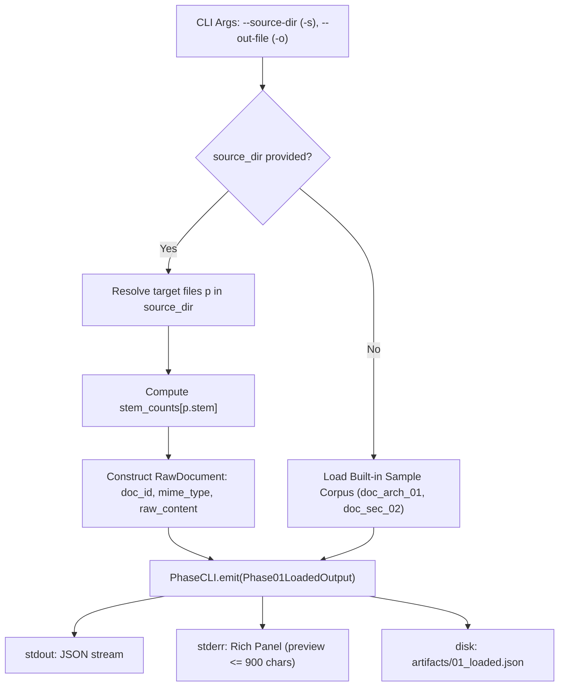

### 6. Mechanics, Variable Assignments & Mutations
1. `source_dir: Path | None`, `out_file: Path`, `quiet: bool` parsed via Typer CLI.
2. `docs: list[RawDocument] = []` initialized.
3. If `source_dir` exists:
   - If `source_dir.is_file()`: `targets = [source_dir]`.
   - Else: `targets = sorted([p for p in source_dir.glob("*.*") if p.is_file()])`.
4. `stem_counts: dict[str, int]` populated by counting occurrences of each `p.stem`.
5. Iteration over `targets`:
   - `mime = "text/markdown"` if `p.suffix in (".md", ".markdown")` else `"text/html"` if `p.suffix in (".html", ".htm")` else `"text/plain"`.
   - `doc_id = f"{p.stem}_{p.suffix.lstrip('.')}"` if `stem_counts[p.stem] > 1` else `p.stem`.
   - `content = p.read_text(encoding="utf-8", errors="ignore")`.
   - `docs.append(RawDocument(doc_id=doc_id, source_uri=str(p.resolve()), mime_type=mime, raw_content=content))`.
6. If `targets` is empty: load built-in sample HTML and Markdown documents.
7. `output = Phase01LoadedOutput(documents=docs)` instantiated.
8. `cli_engine.emit(output, out_file, quiet)` serializes to disk, stderr, and stdout.

### 7. Phase Input & Output Audit
- **Input:** Filesystem path or `None` (CLI arguments). No upstream Pydantic model (`input_model = None`).
- **Output:** `Phase01LoadedOutput`
  - `run_id`: `str` (ISO-8601 UTC timestamp format `%Y%m%dT%H%M%SZ`).
  - `phase_name`: Literal `"01_loading"`.
  - `timestamp`: ISO-8601 UTC string (`datetime.now(UTC).isoformat()`).
  - `documents`: `list[RawDocument]` with `doc_id: str`, `source_uri: str`, `mime_type: str`, `raw_content: str`.

---

## Phase 02: Markdown Normalization (`rag-p02` / `p02_markdown.py`)

### 1. Purpose & Objectives
Standardizes heterogeneous raw document inputs into clean, unified GitHub Flavored Markdown (GFM). It strips HTML boilerplate, extracts structural headings, removes script and style tags, and records document frontmatter metadata.

### 2. Methodologies Employed
- Substring MIME type discrimination (`"html" in doc.mime_type`).
- Regular expression rewriting under `re.IGNORECASE | re.DOTALL`.
- Structural HTML tag transformation (`<h1>` $\to$ `# `, `<h2>` $\to$ `## `, `
` $\to$ `\n\n`).
- Document length and MIME metadata preservation in frontmatter.

### 3. Formal Equations & Techniques (MathJax)
Let $(d, \mu, S_{\text{raw}})$ be an incoming raw document. The normalization transformation $\mathcal{M}: \Sigma^* \times \Sigma^* \to \Sigma^*$ is:
$$\mathcal{M}(S_{\text{raw}}, \mu) = \begin{cases} \mathcal{N}(S_{\text{raw}}), & \text{if } \text{"html"} \subseteq \mu \\ \text{trim}(S_{\text{raw}}), & \text{otherwise} \end{cases}$$
Where the HTML normalization operator is:
$$\mathcal{N} = \text{trim} \circ \mathcal{R}_{\text{tag\_strip}} \circ \mathcal{R}_{p} \circ \mathcal{R}_{h2} \circ \mathcal{R}_{h1}$$
With regular grammar rewriting rules under flags $\mathcal{F} = \text{IGNORECASE} \mid \text{DOTALL}$:
$$\begin{aligned}
\mathcal{R}_{h1}(S) &= \text{sub}(S, \texttt{<h1>(.*?)</h1>}, \texttt{\# \textbackslash 1\textbackslash n\textbackslash n}) \\
\mathcal{R}_{h2}(S) &= \text{sub}(S, \texttt{<h2>(.*?)</h2>}, \texttt{\#\# \textbackslash 1\textbackslash n\textbackslash n}) \\
\mathcal{R}_{p}(S) &= \text{sub}(S, \texttt{
(.*?)
}, \texttt{\textbackslash 1\textbackslash n\textbackslash n}) \\
\mathcal{R}_{\text{tag\_strip}}(S) &= \text{sub}(S, \texttt{<[\^{}>]+>}, \varepsilon)
\end{aligned}$$
Frontmatter metadata records:
$$\text{frontmatter} = \{\text{"original\_mime"}: \mu, \text{"char\_len"}: |\mathcal{M}(S_{\text{raw}}, \mu)|\}$$

### 4. Pros, Cons, and Possible Alternatives
- **Pros:** Pure standard library execution without heavy HTML parsers; deterministic output; preserves semantic heading structures.
- **Cons:** Regex HTML parsing does not handle arbitrarily nested HTML tables, spans, or non-semantic DOM trees.
- **Alternatives:**
  - *Readability.js / BeautifulSoup4:* Better DOM tree traversal and semantic main-content extraction at the cost of execution latency and extra dependencies.
  - *Pandoc subprocess:* Universal document conversion supporting docx, rtf, pdf, but requires external system binaries.

### 5. Data Flow Diagram
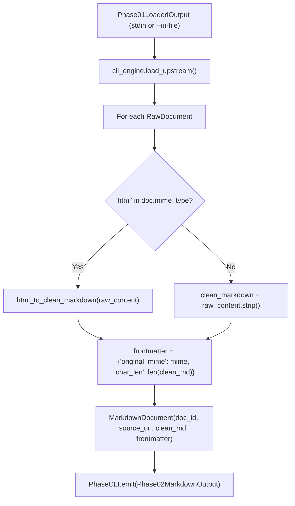

### 6. Mechanics, Variable Assignments & Mutations
1. `upstream: Phase01LoadedOutput = cli_engine.load_upstream(in_file)` validates incoming JSON against strict schema.
2. `md_docs: list[MarkdownDocument] = []` initialized.
3. Iteration over `upstream.documents`:
   - If `"html" in doc.mime_type`: `clean_md = html_to_clean_markdown(doc.raw_content)`.
   - Else: `clean_md = doc.raw_content.strip()`.
   - `frontmatter = {"original_mime": doc.mime_type, "char_len": len(clean_md)}`.
   - `md_docs.append(MarkdownDocument(doc_id=doc.doc_id, source_uri=doc.source_uri, clean_markdown=clean_md, frontmatter=frontmatter))`.
4. `output = Phase02MarkdownOutput(documents=md_docs, run_id=upstream.run_id)`.
5. `cli_engine.emit(output, out_file, quiet)`.

### 7. Phase Input & Output Audit
- **Input:** `Phase01LoadedOutput` (contains `documents: list[RawDocument]`).
- **Output:** `Phase02MarkdownOutput`
  - `run_id`: Propagated from upstream (`upstream.run_id`).
  - `phase_name`: Literal `"02_preprocess_md"`.
  - `timestamp`: ISO-8601 UTC string.
  - `documents`: `list[MarkdownDocument]` with `doc_id`, `source_uri`, `clean_markdown`, `frontmatter: dict[str, Any]` (default factory `dict`).

---

## Phase 03: Structural AST Parsing (`rag-p03` / `p03_parse.py`)

### 1. Purpose & Objectives
Decomposes flat normalized Markdown into an Abstract Syntax Tree (AST) of semantic sections based on Markdown heading levels (`#`, `##`, `###`). It builds a hierarchical breadcrumb trail (`header_path`) for each section, preserving structural context.

### 2. Methodologies Employed
- Line-by-line stateful Markdown AST traversal.
- Heading depth tracking ($\text{level} = \text{count}(\text{"\#"}))$.
- Stack truncation and pushing to maintain exact parent-child breadcrumb paths.
- Deterministic section ID generation (`f"{doc_id}_sec_{index}"`).

### 3. Formal Equations & Techniques (MathJax)
Let document lines be $L = (l_1, \dots, l_M)$. A line $l_k$ is a heading if it matches regex $\texttt{\^{}(\#\{1,6\})\textbackslash s+(.*)}$.
Depth $d(l_k) \in \{1, \dots, 6\}$ and title $t(l_k) \in \Sigma^*$ are extracted.
Let the heading stack at line $k$ be $\mathbf{H}_k \in (\Sigma^*)^*$, initialized as $\mathbf{H}_0 = ()$.
When heading $l_k$ is encountered:
$$\mathbf{H}_k = \mathbf{H}_{k-1}\left[1 : \min(d(l_k) - 1, |\mathbf{H}_{k-1}|)\right] \mathbin{\Vert} (t(l_k))$$
When $l_k$ is non-heading, $\mathbf{H}_k = \mathbf{H}_{k-1}$ and line is buffered into `buffer`.
A section $S_j$ is emitted upon heading encounter or EOF if and only if `buffer` is non-empty:
$$S_j = \left( \text{sec\_id}_j, \text{doc\_id}, \mathbf{H}(S_j), \text{trim}(\text{buffer}), \text{meta} \right)$$
Where:
$$\mathbf{H}(S_j) = \begin{cases} \mathbf{H}_k, & \text{if } \mathbf{H}_k \ne () \\ (\text{"Root"}), & \text{if } \mathbf{H}_k = () \end{cases}, \quad \text{sec\_id}_j = \text{doc\_id} \mathbin{\Vert} \text{"\_sec\_"} \mathbin{\Vert} j$$

### 4. Pros, Cons, and Possible Alternatives
- **Pros:** Preserves natural document hierarchy; prevents section bleed; contextualizes sub-sections with their top-level chapter context.
- **Cons:** If documents lack Markdown headers, the entire text falls into a single unsegmented root section.
- **Alternatives:**
  - *Tree-sitter Markdown parser:* True syntax tree compilation; handles edge cases like headers inside code fences.
  - *TextTiling / Topic Segmentation:* Statistical/lexical cohesion segmentation for headerless documents.

### 5. Data Flow Diagram
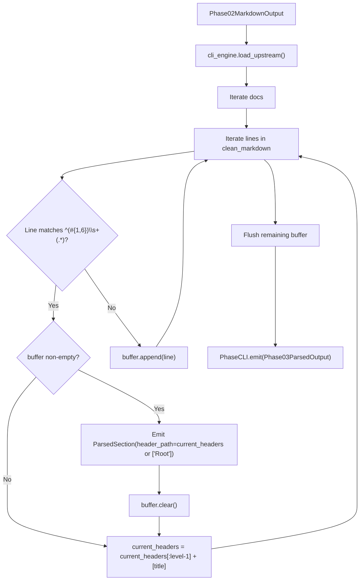

### 6. Mechanics, Variable Assignments & Mutations
1. `upstream: Phase02MarkdownOutput = cli_engine.load_upstream(in_file)`.
2. `all_sections: list[ParsedSection] = []` initialized.
3. For each `doc in upstream.documents`:
   - `current_headers: list[str] = []`
   - `buffer: list[str] = []`
   - `sec_idx = 0`
   - Line iteration:
     - Match $m = \text{re.match}(\texttt{\^{}(\#\{1,6\})\textbackslash s+(.*)}, \text{line})$:
     - If matched:
       - If `buffer`:
         - `all_sections.append(ParsedSection(section_id=f"{doc.doc_id}_sec_{sec_idx}", doc_id=doc.doc_id, header_path=list(current_headers) or ["Root"], body="\n".join(buffer).strip(), metadata={"source_uri": doc.source_uri}))`
         - `sec_idx += 1`
         - `buffer.clear()`
       - `level = len(m.group(1))`
       - `title = m.group(2).strip()`
       - `current_headers = current_headers[:level-1] + [title]`
     - Else: `buffer.append(line)`
   - Remainder flush: If `buffer` is non-empty, emit final `ParsedSection` and increment `sec_idx`.
4. `output = Phase03ParsedOutput(sections=all_sections, run_id=upstream.run_id)`.
5. `cli_engine.emit(output, out_file, quiet)`.

### 7. Phase Input & Output Audit
- **Input:** `Phase02MarkdownOutput` (contains `documents: list[MarkdownDocument]`).
- **Output:** `Phase03ParsedOutput`
  - `run_id`: Upstream run ID.
  - `phase_name`: Literal `"03_parsing"`.
  - `timestamp`: ISO-8601 UTC string.
  - `sections`: `list[ParsedSection]` with `section_id`, `doc_id`, `header_path: list[str]`, `body: str`, `metadata: dict[str, Any]`.

---

## Phase 04: Semantic Sliding-Window Chunking (`rag-p04` / `p04_chunk.py`)

### 1. Purpose & Objectives
Divides parsed sections into fixed-word overlapping windows suitable for embedding models while maintaining full parent section context (`parent_markdown`) to enable late-chunking context expansion and parent deduplication.

### 2. Methodologies Employed
- Word-level sliding window segmentation with parameterized capacity $W = 60$ and overlap $O = 12$ ($S = 48$).
- Parent Markdown preservation: includes the section's reconstructed markdown header and full body.
- Token count approximation via whitespace word split.

### 3. Formal Equations & Techniques (MathJax)
Let section body words be $\mathbf{w} = (w_0, w_1, \dots, w_{T-1})$ with $T = |\mathbf{w}|$.
Given window capacity $W = 60$ and overlap $O = 12$, the sliding stride is:
$$S = \max(1, W - O) = 48$$
The exact total chunk count $K$ produced by `range(0, max(1, T), S)` with non-empty guard is:
$$K = \begin{cases} 0, & \text{if } T = 0 \\ \left\lceil \frac{T}{S} \right\rceil, & \text{if } T > 0 \end{cases}$$
For $k \in \{0, 1, \dots, K-1\}$, the $k$-th child chunk spans 0-indexed half-open word interval:
$$\text{chunk}_k = \left( w_{k \cdot S}, w_{k \cdot S + 1}, \dots, w_{\min(k \cdot S + W, T) - 1} \right)$$
With deterministic chunk identifier and token count:
$$\text{chunk\_id}_k = \text{section\_id} \mathbin{\Vert} \text{"\_chk\_"} \mathbin{\Vert} k, \quad \text{token\_count}_k = \min(k \cdot S + W, T) - k \cdot S$$
The contextual parent Markdown is reconstructed as:
$$\text{parent\_markdown} = \text{"\#\#\# "} \mathbin{\Vert} \left( \bigotimes_{i=1}^m \mathbf{H}_i \right) \mathbin{\Vert} \text{"\textbackslash n"} \mathbin{\Vert} \text{body}$$

### 4. Pros, Cons, and Possible Alternatives
- **Pros:** Predictable chunk sizes; overlap prevents semantic boundary clipping; parent markdown retention allows downstream expansion.
- **Cons:** Word-based chunking is an approximation of BPE/WordPiece tokenization; may split mid-sentence.
- **Alternatives:**
  - *Recursive Character Text Splitter (LangChain/LlamaIndex):* Splits on `["\n\n", "\n", " ", ""]`.
  - *Semantic Chunker (Embedding distance threshold):* Splits when cosine distance between consecutive sentences exceeds threshold $\tau$.

### 5. Data Flow Diagram
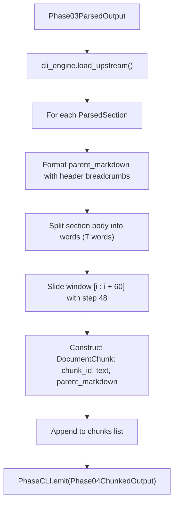

### 6. Mechanics, Variable Assignments & Mutations
1. `max_words: int = 60`, `overlap: int = 12` configured via Typer CLI.
2. `step = max(1, max_words - overlap)` (evaluates to $48$).
3. `chunks: list[DocumentChunk] = []` initialized.
4. For each `sec in upstream.sections`:
   - `header_prefix = " > ".join(sec.header_path)`
   - `parent_md = f"### {header_prefix}\n{sec.body}"`
   - `words = sec.body.split()`
   - Loop `idx = 0`; for `i in range(0, max(1, len(words)), step)`:
     - `slice_words = words[i : i + max_words]`
     - If not `slice_words`: continue
     - `chunk_text = " ".join(slice_words)`
     - `chunks.append(DocumentChunk(chunk_id=f"{sec.section_id}_chk_{idx}", parent_section_id=sec.section_id, doc_id=sec.doc_id, text=chunk_text, token_count=len(slice_words), header_hierarchy=sec.header_path, parent_markdown=parent_md))`
     - `idx += 1`
5. `output = Phase04ChunkedOutput(chunks=chunks, run_id=upstream.run_id)`.
6. `cli_engine.emit(output, out_file, quiet)`.

### 7. Phase Input & Output Audit
- **Input:** `Phase03ParsedOutput` (contains `sections: list[ParsedSection]`).
- **Output:** `Phase04ChunkedOutput`
  - `run_id`: Upstream run ID.
  - `phase_name`: Literal `"04_chunking"`.
  - `timestamp`: ISO-8601 UTC string.
  - `chunks`: `list[DocumentChunk]` with `chunk_id`, `parent_section_id`, `doc_id`, `text`, `token_count`, `header_hierarchy`, `parent_markdown`.

---

## Phase 05: Hybrid Qdrant Indexing (`rag-p05` / `p05_index.py`)

### 1. Purpose & Objectives
Transforms textual chunks into dual dense and sparse semantic representations, contextualizes texts with document and section prefixes, and indexes them into an embedded or remote Qdrant vector database using deterministic UUIDv5 point IDs.

### 2. Methodologies Employed
- **Contextual Retrieval Prefixing:** Prepends `[Doc: <doc_id> | Section: <breadcrumbs>] <chunk_text>`.
- **Dense Embedding:** `jinaai/jina-embeddings-v3` (1024-dimensional, cosine similarity, INT8 scalar quantization with 0.99 quantile clipping).
- **Sparse Representation:** `prithivida/Splade_PP_en_v1` (SPLADE++ lexical neural weights).
- **Deterministic Point IDs:** UUIDv5 seeded strictly on `chunk_id`.
- **Linear Client Closing:** Explicit `client.close()` at phase completion.

### 3. Formal Equations & Techniques (MathJax)
The contextual retrieval prefix prepended to chunk $c$ with identifier $d$ and header trail $\mathbf{H}$ is:
$$\tilde{c} = \text{"[Doc: "} \mathbin{\Vert} d \mathbin{\Vert} \text{" | Section: "} \mathbin{\Vert} \left( \bigotimes_{i=1}^{m} \mathbf{H}_i \right) \mathbin{\Vert} \text{"] "} \mathbin{\Vert} c$$
Where $\bigotimes$ joins elements with $\text{" > "}$.
Dense embedding generates unit-norm vector $\mathbf{v}_{\text{dense}} \in \mathbb{S}^{1023} \subset \mathbb{R}^{1024}$:
$$\mathbf{v}_{\text{dense}} = \frac{\text{Encoder}_{\text{Jina}}(\tilde{c})}{\|\text{Encoder}_{\text{Jina}}(\tilde{c})\|_2}$$
Sparse SPLADE++ neural lexical expansion generates $\mathbf{v}_{\text{sparse}} \in \mathbb{R}^{|V|}$ where $|V| \approx 30522$:
$$s_j = \max_{t \in \tilde{c}} \log \left( 1 + \text{ReLU}\left( (W_{\text{vocab}} \mathbf{h}_t + b)_j \right) \right), \quad \forall j \in \{1, \dots, |V|\}$$
The deterministic point UUID $u$ in Qdrant is strictly:
$$u = \text{UUIDv5}\left( \text{NAMESPACE\_DNS}, \text{chunk\_id} \right)$$
Qdrant INT8 Scalar Quantization with 0.99 quantile clipping:
Let $q_{0.01}, q_{0.99}$ be the 1st and 99th percentiles of coordinate amplitudes across indexed vectors, with scale $\alpha = \frac{q_{0.99} - q_{0.01}}{255}$. Quantized coordinates are:
$$\hat{v}_i = \text{clamp}\left( \left\lfloor \frac{v_i - q_{0.01}}{\alpha} - 128 \right\rceil, -128, 127 \right)$$

### 4. Pros, Cons, and Possible Alternatives
- **Pros:** SOTA hybrid search combining lexical exact matches with high-dimensional semantic vectors; INT8 quantization cuts memory footprint by 75%; UUIDv5 ensures idempotent indexing.
- **Cons:** Embedding two representations increases ingestion compute time and memory usage during index generation.
- **Alternatives:**
  - *BM25 instead of SPLADE:* Lower compute overhead but lacks neural term expansion.
  - *BGE-M3:* Multi-functional model producing dense, sparse, and multi-vector representations in a single forward pass.

### 5. Data Flow Diagram
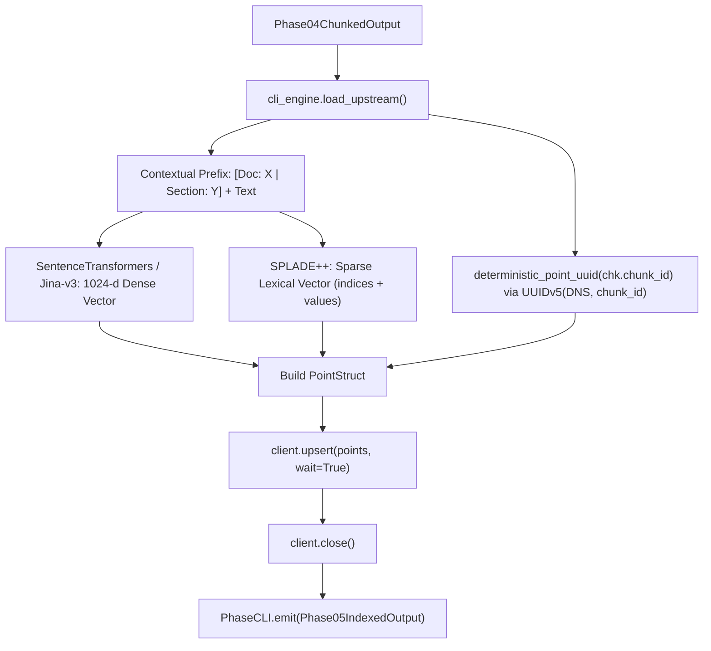

### 6. Mechanics, Variable Assignments & Mutations
1. CLI options: `collection_name: str`, `qdrant_path: Path`, `qdrant_url: str | None`, `recreate: bool`.
2. `upstream: Phase04ChunkedOutput = cli_engine.load_upstream(in_file)`.
3. `client = get_qdrant_client(qdrant_path=qdrant_path, qdrant_url=qdrant_url)`.
4. `ensure_hybrid_collection(client, collection_name=collection_name, recreate=recreate)`.
5. For each `chk in upstream.chunks`:
   - `header_str = " > ".join(chk.header_hierarchy) or "Root"`
   - `prefixed = f"[Doc: {chk.doc_id} | Section: {header_str}] {chk.text}"`
6. `dense_vecs = embed_dense_batch(texts)`.
7. `sparse_indices_list, sparse_values_list = embed_sparse_batch(texts)`.
8. Point construction:
   - `point_id = deterministic_point_uuid(chk.chunk_id)`
   - `models.PointStruct(id=point_id, vector={"jina-dense": dense_vecs[i], "splade-sparse": models.SparseVector(indices=sparse_indices_list[i], values=sparse_values_list[i])}, payload={...})`
9. `client.upsert(collection_name=collection_name, points=points, wait=True)`.
10. `client.close()`.
11. `cli_engine.emit(Phase05IndexedOutput(...), out_file, quiet)`.

### 7. Phase Input & Output Audit
- **Input:** `Phase04ChunkedOutput` (contains `chunks: list[DocumentChunk]`).
- **Output:** `Phase05IndexedOutput`
  - `run_id`: Upstream run ID.
  - `phase_name`: Literal `"05_contextual_index"`.
  - `timestamp`: ISO-8601 UTC string.
  - `qdrant_collection`: Name of targeted collection.
  - `indexed_records`: `list[EnrichedIndexedChunk]` with `chunk_id`, `doc_id`, `contextualized_text`, `dense_vector`, `sparse_indices`, `sparse_values`, `parent_markdown`, `header_hierarchy`.

---

## Phase 06: Query Decomposition & HyDE Plan (`rag-p06` / `p06_query.py`)

### 1. Purpose & Objectives
Prepares user queries for hybrid retrieval by decomposing multi-part questions across conjunctions, assigning routing metadata, and synthesizing a Hypothetical Document Embedding (HyDE) passage to bridge semantic vocabulary mismatch.

### 2. Methodologies Employed
- Lexical multi-query splitting: `query.replace(" and ", " | ").split("|")`.
- Static architectural routing: `"hybrid_rag_multi_query"`.
- Zero-shot Hypothetical Document Embedding (HyDE) specification synthesis.

### 3. Formal Equations & Techniques (MathJax)
Query decomposition splits query $Q$ across conjunctions:
$$\mathcal{D}(Q) = \left\{ \text{trim}(q) \;\middle|\; q \in \text{split}\left(\text{replace}(Q, \text{" and "}, \text{" | "}), \text{"|"} \right), \; \text{len}(\text{trim}(q)) > 0 \right\}$$
The zero-shot HyDE passage synthesis operator $\mathcal{G}_{\text{HyDE}}: \Sigma^* \to \Sigma^*$ emits:
$$P_{\text{hyde}} = \text{"Technical specification answering '"} \mathbin{\Vert} Q \mathbin{\Vert} \text{"': Hybrid RAG combines Qdrant HNSW dense embeddings with SPLADE sparse vectors via Reciprocal Rank Fusion (RRF) and verifies relevance via CRAG."}$$
The combined dense query string $\tilde{Q}_{\text{dense}}$ in Phase 07 combines query and HyDE passage via newline:
$$\tilde{Q}_{\text{dense}} = Q \mathbin{\Vert} \text{"\textbackslash n"} \mathbin{\Vert} P_{\text{hyde}}, \quad \mathbf{q}_{\text{dense}} = \text{Encoder}_{\text{dense}}(\tilde{Q}_{\text{dense}})$$
While sparse retrieval embeds raw query: $\mathbf{q}_{\text{sparse}} = \text{Encoder}_{\text{sparse}}(Q)$.

### 4. Pros, Cons, and Possible Alternatives
- **Pros:** HyDE closes the semantic gap between short questions and dense technical document passages; sub-queries improve recall for composite questions.
- **Cons:** If HyDE hallucinates incorrect domain entities, dense retrieval can be steered towards irrelevant documents.
- **Alternatives:**
  - *LLM Multi-Query Expansion:* Using an instruction-tuned LLM to generate 3 diverse search paraphrases.
  - *Step-Back Prompting:* Formulating high-level conceptual questions to retrieve foundational context.

### 5. Data Flow Diagram
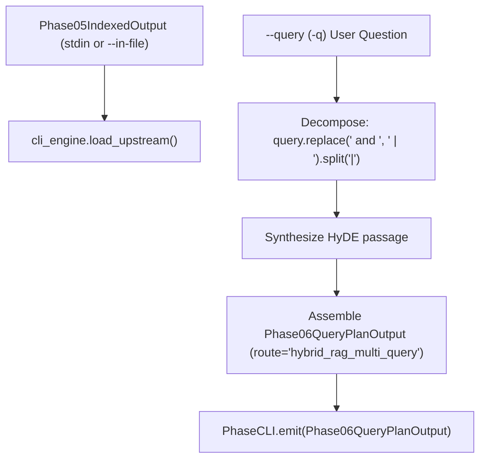

### 6. Mechanics, Variable Assignments & Mutations
1. CLI options: `query: str` (default provided), `in_file: Path | None`, `out_file: Path`, `quiet: bool = Option(False, "--quiet", "-s")`.
2. `upstream: Phase05IndexedOutput = cli_engine.load_upstream(in_file)`.
3. `sub_queries = [q.strip() for q in query.replace(" and ", " | ").split("|") if q.strip()]` (falls back to `[query]`).
4. `route = "hybrid_rag_multi_query"`.
5. `hyde_passage = f"Technical specification answering '{query}': Hybrid RAG combines Qdrant HNSW dense embeddings with SPLADE sparse vectors via Reciprocal Rank Fusion (RRF) and verifies relevance via CRAG."`.
6. `output = Phase06QueryPlanOutput(run_id=upstream.run_id, original_query=query, route=route, sub_queries=sub_queries, hyde_passage=hyde_passage, metadata_filters={"collection": upstream.qdrant_collection}, qdrant_collection=upstream.qdrant_collection)`. (Since 0.2.0: the full P05 payload is no longer embedded; only the collection name crosses to P07, the chunks reach P07 through Qdrant.)
7. `cli_engine.emit(output, out_file, quiet)`.

### 7. Phase Input & Output Audit
- **Input:** `Phase05IndexedOutput` (contains indexed database snapshot).
- **Output:** `Phase06QueryPlanOutput`
  - `run_id`: Upstream run ID.
  - `phase_name`: Literal `"06_query_orchestration"`.
  - `timestamp`: ISO-8601 UTC string.
  - `original_query`: `str`
  - `route`: `str`
  - `sub_queries`: `list[str]`
  - `hyde_passage`: `str`
  - `metadata_filters`: `dict[str, Any]`
  - `qdrant_collection`: `str` (replaced `index_snapshot: Phase05IndexedOutput` in 0.2.0; legacy artifacts carrying `index_snapshot` are rejected with `extra_forbidden`).

---

## Phase 07: Hybrid Prefetch + RRF Retrieval (`rag-p07` / `p07_retrieve.py`)

### 1. Purpose & Objectives
Executes a unified hybrid search query against Qdrant by dispatching dual prefetch operations—dense vector search (query + newline + HyDE) and sparse lexical search (raw query terms)—and fusing candidate rankings via weighted Reciprocal Rank Fusion (RRF, $k=60$). To provide full operational transparency, it captures branch scores across dense, sparse, and fused rankings.

### 2. Methodologies Employed
- Universal Query API using Qdrant `query_points()`.
- Dual branch `Prefetch` query clauses (`jina-dense` and `splade-sparse`).
- In-engine Reciprocal Rank Fusion (`models.RrfQuery(rrf=models.Rrf(k=rrf_k, weights=[...]))`).
- Branch score mapping: executes standalone dense and sparse queries to capture individual diagnostic scores before hybrid fusion.
- Linear `client.close()` at termination.

### 3. Formal Equations & Techniques (MathJax)
Let $\mathcal{R}_{\text{dense}}, \mathcal{R}_{\text{sparse}} \subset \mathcal{X}$ be candidate pools of size $\le L$ ($L=25$, `--prefetch-limit`) retrieved via:
$$\begin{aligned}
\mathcal{R}_{\text{dense}} &= \text{Top-}L_{\mathbf{d} \in \mathcal{X}} \left( \frac{\mathbf{q}_{\text{dense}} \cdot \mathbf{d}}{\|\mathbf{q}_{\text{dense}}\|_2 \|\mathbf{d}\|_2} \right) \\
\mathcal{R}_{\text{sparse}} &= \text{Top-}L_{\mathbf{s} \in \mathcal{X}} \left( \sum_{j \in V} q_{\text{sparse}, j} \cdot s_j \right)
\end{aligned}$$
Let $r_m(d) \in \{1, 2, \dots, L\}$ be the 1-based ordinal rank of document $d$ in prefetch branch $m \in \{\text{dense}, \text{sparse}\}$.
The parameterized Reciprocal Rank Fusion (RRF) score is:
$$\text{RRF}(d) = \sum_{m \in \{\text{dense}, \text{sparse}\}} \mathbb{I}(d \in \mathcal{R}_m) \cdot \frac{w_m}{k + r_m(d)}$$
Where $k = 60$, $w_{\text{dense}} = 1.0$, $w_{\text{sparse}} = 1.0$.
The final retrieved candidate set is:
$$\mathcal{C}_{\text{retrieved}} = \text{Top-}K_{\text{top}} \left( \{ d \in \mathcal{R}_{\text{dense}} \cup \mathcal{R}_{\text{sparse}} \mid \text{by } \text{RRF}(d) \} \right)$$

### 4. Pros, Cons, and Possible Alternatives
- **Pros:** Combines semantic abstraction with exact keyword precision; RRF operates without requiring score calibration across heterogeneous spaces.
- **Cons:** RRF discards raw score magnitudes, relying solely on relative ordinal rank.
- **Alternatives:**
  - *Convex Combination / Relative Score Fusion:* $\text{Score}(d) = \alpha \cdot \text{DenseScore} + (1 - \alpha) \cdot \text{SparseScore}$ with Min-Max normalization.
  - *ColBERT / Late Interaction:* Token-level MaxSim operations preserving token interactions across query and document.

### 5. Data Flow Diagram
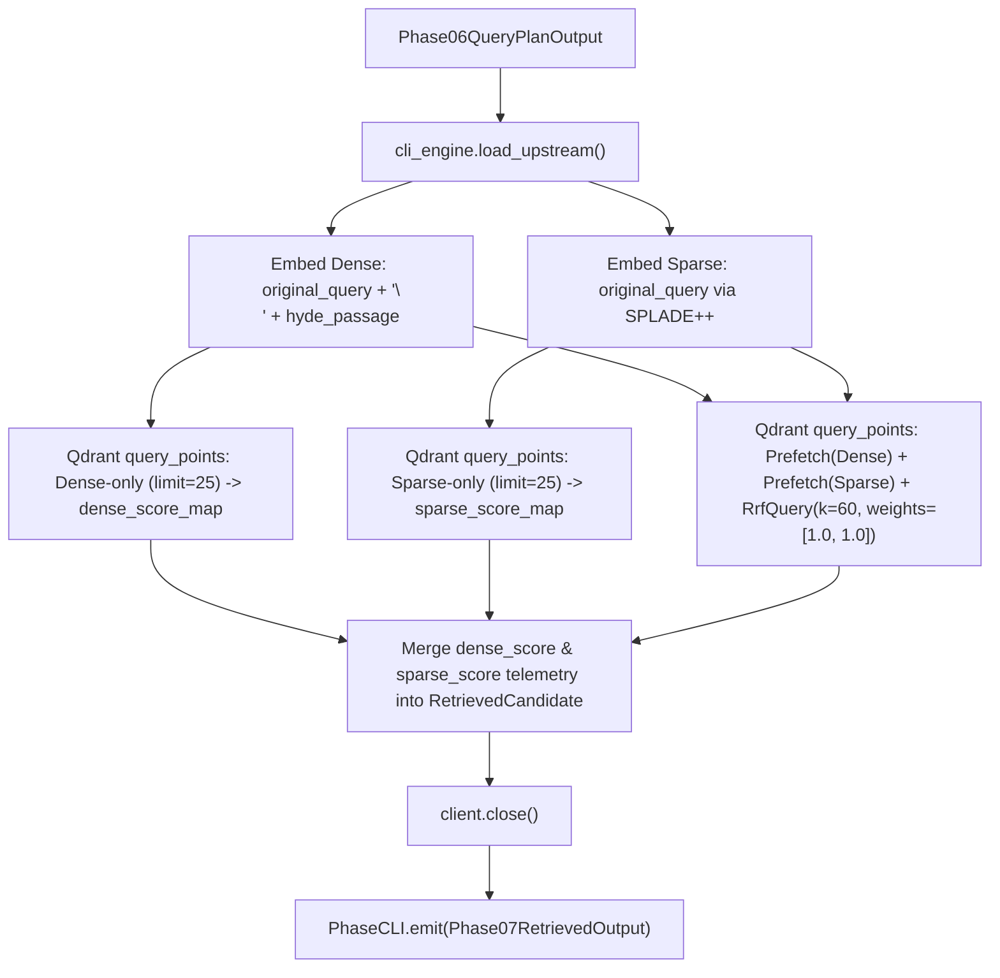

### 6. Mechanics, Variable Assignments & Mutations
1. CLI options: `top_k: int = 10`, `prefetch_limit: int = 25`, `rrf_k: int = 60`, `dense_weight: float = 1.0`, `sparse_weight: float = 1.0`.
2. `upstream: Phase06QueryPlanOutput = cli_engine.load_upstream(in_file)`.
3. Dense query: `query_dense_text = f"{upstream.original_query}\n{upstream.hyde_passage}"`.
4. `dense_vec = embed_dense_batch([query_dense_text])[0]`.
5. `s_idx, s_val = embed_sparse_batch([upstream.original_query])`.
6. Client execution:
   - Query 1: Standalone dense query (`using="jina-dense"`) populates `dense_score_map: dict[str, float]`.
   - Query 2: Standalone sparse query (`using="splade-sparse"`) populates `sparse_score_map: dict[str, float]`.
   - Query 3: Multi-prefetch RRF hybrid query with `models.RrfQuery(rrf=models.Rrf(k=rrf_k, weights=[dense_weight, sparse_weight]))`.
7. Iterate hybrid points: construct `RetrievedCandidate` merging `dense_score_map.get(chunk_id, 0.0)`, `sparse_score_map.get(chunk_id, 0.0)`, and `point.score` (RRF).
8. `client.close()`.
9. `cli_engine.emit(Phase07RetrievedOutput(...), out_file, quiet)`.

### 7. Phase Input & Output Audit
- **Input:** `Phase06QueryPlanOutput` (contains query plan and collection snapshot).
- **Output:** `Phase07RetrievedOutput`
  - `run_id`: Upstream run ID.
  - `phase_name`: Literal `"07_hybrid_retrieval"`.
  - `timestamp`: ISO-8601 UTC string.
  - `query_plan`: Upstream `Phase06QueryPlanOutput`.
  - `candidates`: `list[RetrievedCandidate]` with `chunk_id`, `doc_id`, `contextualized_text`, `parent_markdown`, `dense_score`, `sparse_score`, `rrf_fused_score`.

---

## Phase 08: Cross-Encoder Reranking & Lost-in-the-Middle XML (`rag-p08` / `p08_rerank.py`)

### 1. Purpose & Objectives
Applies full Cross-Encoder deep attention scoring across candidate `(query, passage)` pairs, normalizes logits to calibrated probabilities, deduplicates redundant child chunks sharing identical parent Markdown sections, and reorders top contexts using **Lost-in-the-Middle** positioning within a structured `<retrieved_context>` XML block.

### 2. Methodologies Employed
- Dual-backend Cross-Encoder execution: `transformers` (PyTorch) or `fastembed` (ONNX).
- Sigmoid calibration mapping raw real logits $z \in (-\infty, \infty)$ to $[0.0, 1.0]$ with exponent clamping and numerical stability guards.
- Parent section deduplication via content hash keying.
- **Lost-in-the-Middle (LITM)** attention reordering: places top-relevance passages at the beginning and end of the prompt to mitigate middle-context LLM attention degradation.
- Dual representation contract: `top_contexts` is strictly sorted descending by score, while `xml_context_block` receives the LITM permutation.

### 3. Formal Equations & Techniques (MathJax)
For candidate passage $p_i$ and query $q$, let $z_i = \text{CrossEncoder}(q, p_i) \in \mathbb{R}$.
The calibrated confidence score $s_i \in [0.0, 1.0]$ is:
$$s_i = \text{round}\left( \begin{cases} \sigma(\text{clamp}(z_i, -20.0, 20.0)), & \text{if } z_i < 0.0 \lor z_i > 1.0 \\ z_i, & \text{if } 0.0 \le z_i \le 1.0 \end{cases}, \; 4 \right)$$
Where $\sigma(x) = \frac{1}{1 + e^{-x}}$.
**Parent Deduplication:** Candidates sorted descending by $s_i$ are partitioned by parent key $\kappa(c) = \text{doc\_id}(c) \mathbin{\Vert} \text{"::"} \mathbin{\Vert} \text{hash}(\text{expanded\_parent\_context}(c))$. Retaining the first occurrence yields the set of top-$N$ unique parent contexts:
$$\mathcal{C}_{\text{top}} = (c_1, c_2, \dots, c_N), \quad \text{where } s(c_1) \ge s(c_2) \ge \dots \ge s(c_N)$$
**Lost-in-the-Middle (LITM) Alternating Permutation:**
For $N \le 2$, $\mathbf{C}_{\text{litm}} = \mathcal{C}_{\text{top}}$ (identity).
For $N > 2$, let candidate rank be $r \in \{1, 2, \dots, N\}$. The output position $\pi(r) \in \{1, \dots, N\}$ in the XML block is:
$$\pi(r) = \begin{cases} \frac{r + 1}{2}, & \text{if } r \text{ is odd} \\[8pt] N - \frac{r}{2} + 1, & \text{if } r \text{ is even} \end{cases}$$
Conversely, candidate rank placed at XML position $j \in \{1, \dots, N\}$ is given by the inverse permutation $\pi^{-1}(j)$:
$$\pi^{-1}(j) = \begin{cases} 2j - 1, & \text{if } 1 \le j \le \left\lceil \frac{N}{2} \right\rceil \\[8pt] 2(N - j + 1), & \text{if } \left\lceil \frac{N}{2} \right\rceil < j \le N \end{cases}$$
*Example for $N=5$:* $\pi^{-1}(1, 2, 3, 4, 5) = (1, 3, 5, 4, 2)$, placing rank 1 at the start and rank 2 at the end.

### 4. Pros, Cons, and Possible Alternatives
- **Pros:** Cross-Encoder joint attention eliminates bi-encoder information loss; Lost-in-the-Middle maximizes recall of critical facts by LLM attention mechanisms; parent deduplication saves prompt tokens.
- **Cons:** High inference latency compared to bi-encoder retrieval ($O(N)$ transformer forward passes).
- **Alternatives:**
  - *RankGPT (LLM-as-a-reranker):* Uses zero-shot LLM sliding-window permutation generation.
  - *FlashRank:* Ultra-lightweight CPU-optimized ONNX cross-encoders.

### 5. Data Flow Diagram
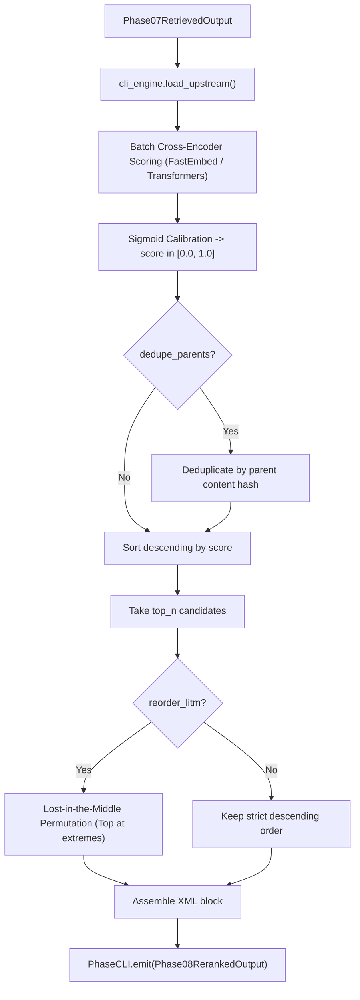

### 6. Mechanics, Variable Assignments & Mutations
1. CLI options: `top_n: int = 5`, `backend: str = "transformers"`, `model_name: str = "BAAI/bge-reranker-v2-m3"`, `dedupe_parents: bool = True`, `reorder_litm: bool = True`.
2. `upstream: Phase07RetrievedOutput = cli_engine.load_upstream(in_file)`.
3. If candidates empty: emits empty `Phase08RerankedOutput` cleanly.
4. Passages extracted: `passages = [cand.contextualized_text for cand in upstream.candidates]`.
5. `ce_scores = rerank_passages_batch(query=upstream.query_plan.original_query, passages=passages, backend=backend, model_name=model_name)`.
6. Scored candidate items paired into `scored_items: list[RerankedContextItem]`, sorted descending by `cross_encoder_score`.
7. If `dedupe_parents`:
   - `deduped_by_parent: dict[str, RerankedContextItem] = {}`
   - Iterate items: `key = f"{item.doc_id}::{hash(item.expanded_parent_context)}"`. Keep first occurrence.
   - `selected = list(deduped_by_parent.values())[:top_n]`.
8. `xml_ordered_items = apply_lost_in_the_middle_ordering(selected)` if `reorder_litm` else `selected`.
9. XML string assembled:
   `<retrieved_context>\n  <document id="..." chunk_id="..." rerank_score="...">...</document>\n</retrieved_context>`.
10. `output = Phase08RerankedOutput(run_id=upstream.run_id, original_query=query, xml_context_block=xml_str, top_contexts=selected)`.
11. `cli_engine.emit(output, out_file, quiet)`.

### 7. Phase Input & Output Audit
- **Input:** `Phase07RetrievedOutput` (contains candidate chunks with hybrid scores).
- **Output:** `Phase08RerankedOutput`
  - `run_id`: Upstream run ID.
  - `phase_name`: Literal `"08_rerank_context"`.
  - `timestamp`: ISO-8601 UTC string.
  - `original_query`: `str`
  - `xml_context_block`: Valid XML string `<retrieved_context>...</retrieved_context>`.
  - `top_contexts`: `list[RerankedContextItem]` (strictly sorted descending by `cross_encoder_score`).

---

## Phase 09: CRAG Verification & Grounded Generation (`rag-p09` / `p09_generate.py`)

### 1. Purpose & Objectives
Acts as the Corrective RAG (CRAG) decision gate. It evaluates retrieval confidence against a calibrated threshold $\theta$, determines whether query rewriting is required, synthesizes an answer strictly grounded in the retrieved XML passages, and binds inline bracketed citations (`[doc_id:chunk_id]`).

### 2. Methodologies Employed
- Corrective RAG threshold gating: evaluates $\max(s_i) \gtrless \theta$ (default $\theta = 0.60$ in standalone CLI, $0.65$ in P00 orchestrator).
- Extractive sentence-level grounded synthesis with lexicographical tuple ranking `(overlap_count: int, cross_encoder_score: float)`.
- Sentence-level duplicate suppression (`seen_text` set).
- Inline citation binding linking each assertion to its originating chunk.

### 3. Formal Equations & Techniques (MathJax)
Let $S = \{s_1, \dots, s_N\}$ be the Cross-Encoder scores of $\mathcal{C}_{\text{top}}$.
The grounded confidence score $C_{\text{grounded}}$ with empty-context fallback is:
$$C_{\text{grounded}} = \begin{cases} \max_{i=1}^N (s_i), & \text{if } N > 0 \\ 0.0, & \text{if } N = 0 \end{cases}$$
The CRAG decision gate $\Phi$ with threshold $\theta \in [0.0, 1.0]$ ($\theta = 0.60$ in P09 CLI, $0.65$ in P00 controller) emits:
$$\Phi(S) = \begin{cases} \text{"GROUNDED"}, & \text{if } C_{\text{grounded}} \ge \theta \\ \text{"REWRITE\_REQUIRED"}, & \text{if } C_{\text{grounded}} < \theta \end{cases}$$
**Extractive Grounding Sentence Ranking:**
Query token set: $T(Q) = \{ \text{lower}(\text{clean}(w)) \mid w \in \text{split}(Q), \; |\text{clean}(w)| \ge 4 \}$.
For candidate sentence $e$ originating from context chunk with score $s(e)$, sentence token set is $T(e) = \{ \text{lower}(\text{clean}(w)) \mid w \in \text{split}(e) \}$.
The ranking key $\mathbf{k}(e) \in \mathbb{N} \times [0, 1]$ is ordered under strict lexicographical precedence $\succ_{\text{lex}}$:
$$\mathbf{k}(e) = \left( |T(e) \cap T(Q)|, \; s(e) \right)$$
Such that sentence $e_1 \succ_{\text{lex}} e_2$ iff:
$$|T(e_1) \cap T(Q)| > |T(e_2) \cap T(Q)| \quad \lor \quad \left( |T(e_1) \cap T(Q)| = |T(e_2) \cap T(Q)| \;\land\; s(e_1) > s(e_2) \right)$$
The synthesized answer concatenates up to 3 deduplicated sentences with inline citation tags:
$$\text{Answer} = \bigoplus_{m=1}^{\min(3, |\mathcal{S}^*|)} \left( e_m \mathbin{\Vert} \text{" ["} \mathbin{\Vert} \text{doc\_id}(e_m) \mathbin{\Vert} \text{":"} \mathbin{\Vert} \text{chunk\_id}(e_m) \mathbin{\Vert} \text{"]"} \right)$$

### 4. Pros, Cons, and Possible Alternatives
- **Pros:** Deterministic hallucination gating; explicit inline citations; prevents generation on ungrounded or low-confidence retrieval.
- **Cons:** Extractive synthesis relies on presence of direct phrasing in the context rather than abstractive generative synthesis.
- **Alternatives:**
  - *Generative LLM Call:* Calling Anthropic Claude, OpenAI, or local Ollama LLM to synthesize natural language prose with constrained citation grammar.
  - *Self-RAG:* In-generation reflection tokens (`[IS_RETRIEVED]`, `[IS_SUPPORTED]`).

### 5. Data Flow Diagram
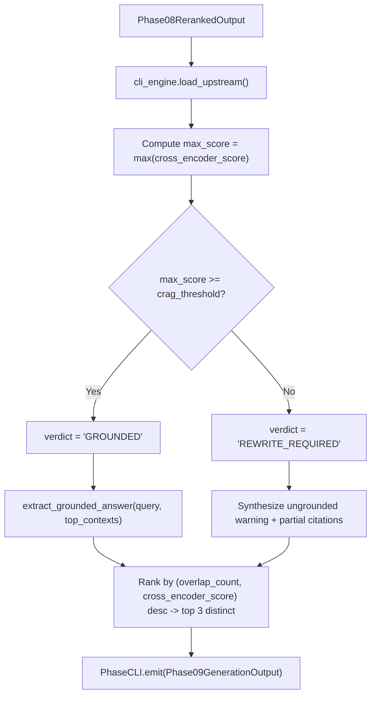

### 6. Mechanics, Variable Assignments & Mutations
1. CLI options: `crag_threshold: float = 0.60`, `in_file: Path | None`, `out_file: Path`.
2. `upstream: Phase08RerankedOutput = cli_engine.load_upstream(in_file)`.
3. `max_score = max((c.cross_encoder_score for c in upstream.top_contexts), default=0.0)`.
4. `verdict = "GROUNDED" if max_score >= crag_threshold else "REWRITE_REQUIRED"`.
5. In `extract_grounded_answer()`:
   - For each context: split sentences on regex `(?<=[.!?])\s+`.
   - Sentences $\le 10$ chars ignored.
   - For each valid sentence: `overlap = len(query_terms & sentence_terms)`.
   - `candidate_sentences.append((overlap, ctx.cross_encoder_score, sentence, ctx.doc_id, ctx.chunk_id))`.
   - `candidate_sentences.sort(key=lambda x: (x[0], x[1]), reverse=True)`.
   - Distinct sentences collected via `seen_text: set[str]`. Top 3 formatted with citations.
6. `output = Phase09GenerationOutput(run_id=upstream.run_id, original_query=upstream.original_query, crag_verdict=verdict, grounded_confidence=max_score, synthesized_answer=synthesized, citations=citations, xml_context_block=upstream.xml_context_block)`.
7. `cli_engine.emit(output, out_file, quiet)`.

### 7. Phase Input & Output Audit
- **Input:** `Phase08RerankedOutput` (contains `top_contexts: list[RerankedContextItem]`).
- **Output:** `Phase09GenerationOutput`
  - `run_id`: Upstream run ID.
  - `phase_name`: Literal `"09_crag_generation"`.
  - `timestamp`: ISO-8601 UTC string.
  - `original_query`: `str`
  - `crag_verdict`: `"GROUNDED"` | `"REWRITE_REQUIRED"`
  - `grounded_confidence`: `float` in $[0.0, 1.0]$.
  - `synthesized_answer`: `str`
  - `citations`: `list[str]` (e.g. `["[doc1:chk_0]"]`).
  - `xml_context_block`: Propagated XML block.

---

## Phase 10: RAG Triad & nDCG Evaluation (`rag-p10` / `p10_evaluate.py`)

### 1. Purpose & Objectives
Performs quantitative telemetry and evaluation of the retrieval and generation pipeline. It computes the **RAG Triad** (Context Precision, Faithfulness, Answer Relevance) and evaluates rank preservation in the prompt context using **Normalized Discounted Cumulative Gain (nDCG@k)**.

### 2. Methodologies Employed
- RAG Triad evaluation framework:
  1. Context Precision: peak cross-encoder retrieval grounding confidence (`round(upstream.grounded_confidence, 4)`).
  2. Faithfulness Score: lexical token overlap with $+0.25$ baseline smoothing prior.
  3. Answer Relevance: substring presence of meaningful query terms ($\ge 4$ characters) in answer text.
- Information Retrieval ranking metric: nDCG@k of Lost-in-the-Middle XML order against ideal Cross-Encoder order.
- Binary hallucination indicator based on faithfulness floor ($< 0.75$).

### 3. Formal Equations & Techniques (MathJax)
**1. Normalized Discounted Cumulative Gain (nDCG@k):**
Let $\mathbf{s} = (s_1, \dots, s_k)$ be the rerank scores extracted from XML in displayed order.
$$\text{DCG}@k = \sum_{i=1}^{k} \frac{s_i}{\log_2(i + 1)}, \quad \text{IDCG}@k = \sum_{i=1}^{k} \frac{s^*_i}{\log_2(i + 1)}$$
Where $\mathbf{s}^* = \text{sort\_descending}(\mathbf{s})$. The guarded nDCG@k metric is:
$$\text{nDCG}@k = \begin{cases} 0.0, & \text{if } k = 0 \\ 1.0, & \text{if } k \le 1 \lor \mathbf{s} = \mathbf{0} \lor \text{IDCG}@k \le 0 \\ \text{round}\left( \text{clamp}\left( \frac{\text{DCG}@k}{\text{IDCG}@k}, 0.0, 1.0 \right), 4 \right), & \text{otherwise} \end{cases}$$

**2. Context Precision:**
In the CLI suite runtime, Context Precision reflects peak retrieval grounding confidence:
$$\text{Context Precision} \triangleq C_{\text{grounded}} = \max_{c \in \mathcal{C}_{\text{top}}} s(c)$$
*(Theoretical IR Signal-to-Noise Ratio reference: $\text{SNR}_\tau = \frac{1}{k} \sum_{i=1}^k \mathbb{I}(s_i \ge \tau)$ with $\tau = 0.30$).*

**3. Faithfulness Score & Hallucination Flag:**
Let $T(A) = \text{set}(\text{split}(\text{lower}(A)))$ and $T(C) = \text{set}(\text{split}(\text{lower}(C_{\text{XML}})))$.
The lexical overlap ratio $\rho$ and $+0.25$ smoothed faithfulness metric are:
$$\rho = \frac{|T(A) \cap T(C)|}{\max(1, |T(A)|)}, \quad \text{Faithfulness} = \text{round}(\min(1.0, \rho + 0.25), 4)$$
The binary hallucination indicator triggers when smoothed faithfulness falls below 0.75:
$$H = \mathbb{I}(\text{Faithfulness} < 0.75) \equiv \mathbb{I}(\rho < 0.50)$$

**4. Answer Relevance:**
Let $T_{\ge 4}(Q) = \{ \text{clean}(\text{lower}(w)) \mid w \in \text{split}(Q), \; |\text{clean}(w)| \ge 4 \}$.
$$\text{Answer Relevance} = \begin{cases} 1.0, & \text{if } T_{\ge 4}(Q) = \emptyset \\ \text{round}\left( \frac{1}{|T_{\ge 4}(Q)|} \sum_{t \in T_{\ge 4}(Q)} \mathbb{I}(t \in \text{lower}(A)), \; 4 \right), & \text{otherwise} \end{cases}$$

### 4. Pros, Cons, and Possible Alternatives
- **Pros:** Completely deterministic, instant calculation ($<5\text{ms}$); zero LLM judge cost; objective and reproducible.
- **Cons:** Token overlap does not capture deep semantic synonyms or abstract entailment compared to neural NLI models.
- **Alternatives:**
  - *Ragas / TruLens:* LLM-as-a-judge prompt evaluation for semantic faithfulness and answer relevance.
  - *T5 / DeBERTa NLI:* Natural Language Inference classification (`entailment`, `neutral`, `contradiction`).

### 5. Data Flow Diagram
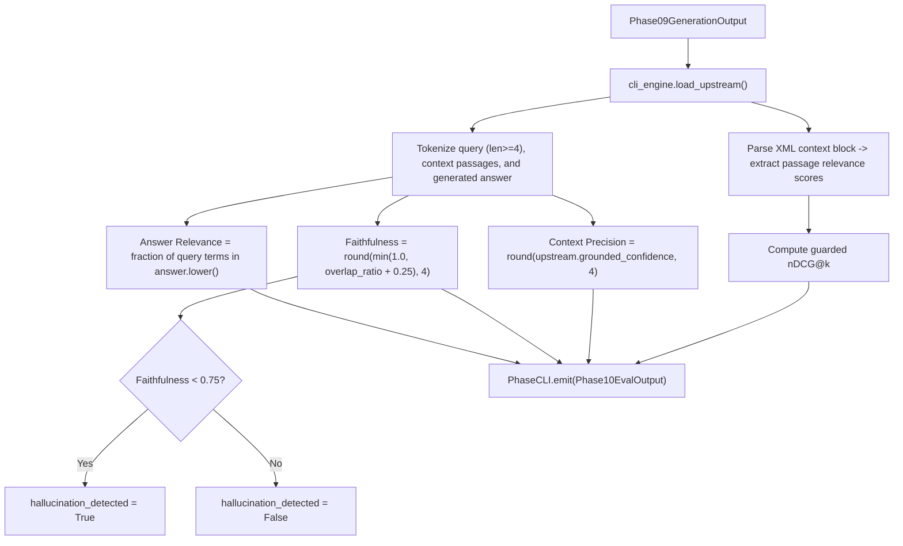

### 6. Mechanics, Variable Assignments & Mutations
1. `upstream: Phase09GenerationOutput = cli_engine.load_upstream(in_file)`.
2. Extract scores from `upstream.xml_context_block` via regex `r'rerank_score="([0-9.]+)"'`.
3. Compute `ndcg = compute_ndcg_at_k(scores)`.
4. `context_precision = round(upstream.grounded_confidence, 4)`.
5. Lexical sets constructed: `ans_tokens = set(re.findall(r"\w+", upstream.synthesized_answer.lower()))`, `ctx_tokens = set(re.findall(r"\w+", upstream.xml_context_block.lower()))`.
6. `overlap_ratio = len(ans_tokens & ctx_tokens) / max(1, len(ans_tokens))`.
7. `faithfulness = round(min(1.0, overlap_ratio + 0.25), 4)`.
8. `hallucination_detected = faithfulness < 0.75`.
9. `answer_relevance = compute_answer_relevance(upstream.original_query, upstream.synthesized_answer)`.
10. `output = Phase10EvalOutput(run_id=upstream.run_id, ndcg_at_k=ndcg, context_precision=context_precision, faithfulness_score=faithfulness, answer_relevance=answer_relevance, hallucination_detected=hallucination_detected, final_answer=upstream.synthesized_answer)`.
11. `cli_engine.emit(output, out_file, quiet)`.

### 7. Phase Input & Output Audit
- **Input:** `Phase09GenerationOutput` (contains answer and XML context block).
- **Output:** `Phase10EvalOutput`
  - `run_id`: Upstream run ID (redeclare `run_id: str` without factory forces unbroken lineage).
  - `phase_name`: Literal `"10_telemetry_eval"`.
  - `timestamp`: ISO-8601 UTC string.
  - `ndcg_at_k`: `float` in $[0.0, 1.0]$.
  - `context_precision`: `float` in $[0.0, 1.0]$.
  - `faithfulness_score`: `float` in $[0.0, 1.0]$.
  - `answer_relevance`: `float` in $[0.0, 1.0]$.
  - `hallucination_detected`: `bool`.
  - `final_answer`: `str`.

---

## Phase 00: Autonomous CRAG Loop Orchestrator (`rag-p00` / `p00_crag_orchestrator.py`)

### 1. Purpose & Objectives
Top-level autonomous pipeline supervisor. It executes the inference cycle (`P06 -> P07 -> P08 -> P09`) as isolated subprocesses, monitors the CRAG decision gate, extracts novel domain lexical anchors from retrieved passages when `crag_verdict == "REWRITE_REQUIRED"`, dynamically rewrites the query across progressive stages, iterates up to `--max-retries`, isolates attempt artifacts, promotes the winning generation to canonical disk paths, and finalizes execution by invoking `P10` for evaluation.

### 2. Methodologies Employed
- Subprocess orchestration with explicit stdin/stdout/stderr stream isolation.
- Iterative feedback loop with retry termination conditions ($t \le T_{\max}$ or $\text{verdict} = \text{"GROUNDED"}$).
- Corpus-grounded lexical anchor extraction: selects up to 4 ordered novel non-stopword tokens ($\ge 4$ chars, not in query, not in `seen_terms`), tracking `seen_terms` globally across attempts.
- Progressive dual query rewriting:
  - Attempt 1: Appends `(specifically addressing: <anchors>)` with fallback.
  - Attempt 2+: Reformulates as `Technical architecture specification for <initial_query> including <anchors>` with fallback.
- In-memory stdin parsing: parses piped stdin directly into `Phase05IndexedOutput` without temporary files.
- Attempt directory sandboxing: saves intermediate attempt artifacts in `artifacts/crag_attempt_<attempt>/`.
- Winning artifact promotion: copies winning `09_generated.json` to canonical disk path before running P10.

### 3. Formal Equations & Techniques (MathJax)
At iteration $t \in \{1, \dots, T_{\max}\}$, let $Q_{t-1}$ be the active query and $p08_t$ emit reranked contexts $\mathcal{C}_t$.
Let stopword set be $\mathcal{V}_{\text{stop}}$ and historical terms set be $\mathcal{V}_{\text{seen}}^{(t-1)}$.
The novel diagnostic anchor sequence $\mathcal{A}_t$ extracts up to 4 ordered tokens from $\mathcal{C}_t$:
$$\mathcal{A}_t = \left[ w \in \text{tokens}(\mathcal{C}_t) \;\middle|\; |w| \ge 4 \land w \notin \mathcal{V}_{\text{stop}} \land w \notin \mathcal{V}_{\text{seen}}^{(t-1)} \land w \notin \text{lower}(Q_{t-1}) \right][:4]$$
State mutation: $\mathcal{V}_{\text{seen}}^{(t)} = \mathcal{V}_{\text{seen}}^{(t-1)} \cup \text{set}(\mathcal{A}_t)$.
The progressive rewritten query $Q_t$ for attempt $t+1$ is:
$$Q_t = \begin{cases} Q_0 \mathbin{\Vert} \text{" (specifically addressing: "} \mathbin{\Vert} \mathcal{E}_1 \mathbin{\Vert} \text{")"}, & \text{if } t = 1 \\ \text{"Technical architecture specification for "} \mathbin{\Vert} Q_0 \mathbin{\Vert} \text{" including "} \mathbin{\Vert} \mathcal{E}_t, & \text{if } t \ge 2 \end{cases}$$
Where anchor expansion $\mathcal{E}_t$ utilizes deterministic domain fallbacks if $\mathcal{A}_t = \emptyset$:
$$\mathcal{E}_t = \begin{cases} \bigoplus_{w \in \mathcal{A}_1} w, & \text{if } t = 1 \land \mathcal{A}_1 \ne \emptyset \\ \text{"Qdrant HNSW dense SPLADE sparse Reciprocal Rank Fusion CRAG"}, & \text{if } t = 1 \land \mathcal{A}_1 = \emptyset \\ \bigoplus_{w \in \mathcal{A}_t} w, & \text{if } t \ge 2 \land \mathcal{A}_t \ne \emptyset \\ \text{"cross-encoder score threshold query rewrite loop late chunking"}, & \text{if } t \ge 2 \land \mathcal{A}_t = \emptyset \end{cases}$$
The loop termination predicate is:
$$\text{Terminated}(t) \iff \Phi(S_t) = \text{"GROUNDED"} \;\lor\; t = T_{\max}$$

### 4. Pros, Cons, and Possible Alternatives
- **Pros:** Completely autonomous self-healing retrieval; transparent attempt-by-attempt audit logs; does not stall on ambiguous queries.
- **Cons:** Multiple retrieval attempts increase latency linearly ($O(T)$ forward passes).
- **Alternatives:**
  - *Web Search Fallback:* When internal corpus lacks answers, fall back to Tavily/Google Search (standard CRAG paper specification).
  - *Multi-Armed Bandit / RL Router:* Dynamically adjust dense/sparse weights rather than rewriting queries.

### 5. Data Flow Diagram
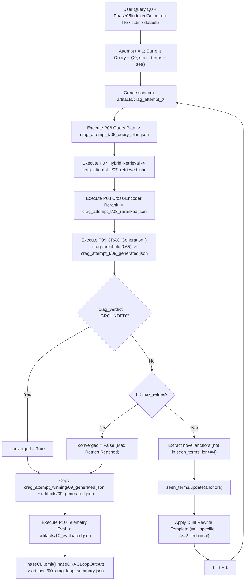

### 6. Mechanics, Variable Assignments & Mutations
1. Inputs: `query: str`, `in_file: Path | None`, `out_file: Path`, `crag_threshold: float = 0.65`, `max_retries: int = 3`, `quiet_children: bool = True`.
2. Input resolution hierarchy:
   - Level 1: `in_file` if provided.
   - Level 2: `stdin` if `not sys.stdin.isatty()` (loaded strictly in-memory into `Phase05IndexedOutput`).
   - Level 3: Default artifact `artifacts/05_indexed.json`.
3. Loop `attempt` from $1$ to `max_retries`:
   - `attempt_dir = out_file.parent / f"crag_attempt_{attempt}"`.
   - Subprocess execution:
     - `p06` with `current_query` $\to$ `attempt_dir / "06_query_plan.json"`.
     - `p07` with `p06_out` $\to$ `attempt_dir / "07_retrieved.json"`.
     - `p08` with `p07_out` $\to$ `attempt_dir / "08_reranked.json"`.
     - `p09` with `p08_out` and `--crag-threshold 0.65` $\to$ `attempt_dir / "09_generated.json"`.
   - `attempts_history.append(CRAGAttemptRecord(attempt=attempt, query_used=current_query, crag_verdict=p09_out.crag_verdict, grounded_confidence=p09_out.grounded_confidence, top_chunk_ids=[c.chunk_id for c in p08_out.top_contexts], rewrite_reason=...))`.
   - If `p09_out.crag_verdict == "GROUNDED"`: `converged = True; winning_p09_path = attempt_p09_path; break`.
   - Else if `attempt < max_retries`:
     - Novel anchors extracted from `p08_out.top_contexts`.
     - Dual template rewrite applied.
4. Promote winning generation: copy `winning_p09_path` to `artifacts/09_generated.json`.
5. Run `p10` with winning generation $\to$ `artifacts/10_evaluated.json`.
6. Construct `PhaseCRAGLoopOutput(run_id=p05_indexed.run_id, initial_query=initial_query, final_query=current_query, total_attempts=len(attempts_history), converged=converged, attempts_history=attempts_history, final_generation=p09_out, final_evaluation=p10_out)`.
7. `cli_engine.emit(output, out_file, quiet)`.

### 7. Phase Input & Output Audit
- **Input:** `Phase05IndexedOutput` (via `--in-file`, stdin pipe, or default artifact).
- **Output:** `PhaseCRAGLoopOutput`
  - `run_id`: Propagated from `p05_indexed.run_id` to preserve audit lineage.
  - `phase_name`: Literal `"00_crag_orchestrator"`.
  - `timestamp`: ISO-8601 UTC string.
  - `initial_query`: `str`
  - `final_query`: `str` (includes injected anchors if rewritten).
  - `total_attempts`: `int` ($\ge 1$).
  - `converged`: `bool`
  - `attempts_history`: `list[CRAGAttemptRecord]` with `attempt: int`, `query_used: str`, `crag_verdict: str`, `grounded_confidence: float`, `top_chunk_ids: list[str]`, `rewrite_reason: str | None` (default `None`).
  - `final_generation`: Embedded `Phase09GenerationOutput`.
  - `final_evaluation`: Embedded `Phase10EvalOutput`.

---

## Complete Phase Pipeline Matrix

| Phase | Executable | Input Schema | Output Schema | Primary Algorithmic Mechanism | Formal Metric / Loss |
|---|---|---|---|---|---|
| **01** | `rag-p01` | Filesystem / Built-in | `Phase01LoadedOutput` | Stem Disambiguation & Ingestion | $f_{\text{doc}}(p) \in \Sigma^*$ |
| **02** | `rag-p02` | `Phase01LoadedOutput` | `Phase02MarkdownOutput` | HTML $\to$ GFM AST Normalization | $\mathcal{R}_{\text{tag\_strip}} \circ \dots \circ \mathcal{R}_{h1}$ |
| **03** | `rag-p03` | `Phase02MarkdownOutput` | `Phase03ParsedOutput` | Header Path Stack Decomposition | $\mathbf{H}_k = (h_1, \dots, h_d)$ |
| **04** | `rag-p04` | `Phase03ParsedOutput` | `Phase04ChunkedOutput` | Sliding-Window Word Segmenter ($W=60, O=12, S=48$) | $K = \lceil T / S \rceil$ |
| **05** | `rag-p05` | `Phase04ChunkedOutput` | `Phase05IndexedOutput` | Jina-v3 1024-d + SPLADE++ Qdrant Upsert | $\text{sim}_{\text{cos}}, \text{sim}_{\text{sparse}}, \text{UUIDv5}(\text{DNS}, \text{chunk\_id})$ |
| **06** | `rag-p06` | `Phase05IndexedOutput` | `Phase06QueryPlanOutput` | Conjunction Split & Zero-Shot HyDE Synthesis | $P_{\text{hyde}} = \mathcal{G}(Q)$ |
| **07** | `rag-p07` | `Phase06QueryPlanOutput` | `Phase07RetrievedOutput` | Multi-Prefetch Reciprocal Rank Fusion ($k=60$) | $\text{RRF}(d) = \sum_b \frac{w_b}{k + r_b(d)}$ |
| **08** | `rag-p08` | `Phase07RetrievedOutput` | `Phase08RerankedOutput` | BGE Cross-Encoder & Lost-in-the-Middle XML | $\sigma(z) = \frac{1}{1 + e^{-z}}, \pi(r), \pi^{-1}(j)$ |
| **09** | `rag-p09` | `Phase08RerankedOutput` | `Phase09GenerationOutput` | CRAG Decision Gate & Lexicographical Ranking | $\mathbf{k}(e) = (|T(e) \cap T(Q)|, s(e)), \Phi(S)$ |
| **10** | `rag-p10` | `Phase09GenerationOutput` | `Phase10EvalOutput` | RAG Triad & Guarded nDCG@k Evaluation | $\text{nDCG}@k, \text{Prec}, \text{Faith}, \text{Relev}$ |
| **00** | `rag-p00` | `Phase05IndexedOutput` | `PhaseCRAGLoopOutput` | Subprocess Orchestration & Progressive Dual Rewrite | Progressive $Q_t, \mathcal{A}^*_t, \mathcal{V}_{\text{seen}}$ |

---

## Edge-Case & Numerical Safety Audit Matrix

| Phase | Mathematical Operation | Potential Vulnerability | Code Mitigation & Invariant | Status |
|---|---|---|---|---|
| **P04** | Stride & Window Step | Division by zero if $W \le O$ | `step = max(1, max_words - overlap)` guarantees $S \ge 1$ | **Verified Safe** |
| **P04** | Empty Body Words | Negative chunk count / zero range | `range(0, max(1, len(words)), step)` with `if not slice_words: continue` safely yields 0 chunks | **Verified Safe** |
| **P07** | RRF Denominator | Zero denominator if $k + r = 0$ | $k \ge 1$ and $r \ge 1 \implies k + r \ge 2 > 0$ strictly | **Verified Safe** |
| **P08** | Sigmoid Calculation | Floating point overflow in $e^{-z}$ | Exponent clamped: $\text{clip}(z, -20.0, 20.0)$ prevents overflow | **Verified Safe** |
| **P08** | LITM Ordering | Out-of-bounds on short candidate lists | `if len(items) <= 2: return items` returns identity order | **Verified Safe** |
| **P08** | Parent Deduplication | Candidate score ties | Stable sorting preserves highest hybrid rank on score ties | **Verified Safe** |
| **P09** | Empty Contexts | $\max(\emptyset)$ crash in CRAG Gate | `max(scores, default=0.0)` returns $0.0$, triggers clean rewrite | **Verified Safe** |
| **P10** | nDCG@k Calculation | Division by zero if $\text{IDCG} = 0$ | If $\text{IDCG} \le 0$ or all scores zero, returns $1.0$; if $k=0$, returns $0.0$ | **Verified Safe** |
| **P10** | Faithfulness Ratio | Division by zero on empty answer | `max(1, len(ans_tokens))` in denominator prevents division by zero | **Verified Safe** |
| **P10** | Answer Relevance | Division by zero on stopword query | `if not q_terms: return 1.0` avoids division by zero | **Verified Safe** |
| **P00** | CRAG Loop Retries | Infinite loop on low confidence | Strict bound $t \le T_{\max}$ with CLI validation `min=1` | **Verified Safe** |
