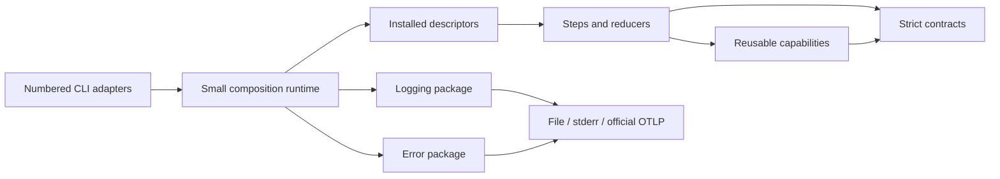

# Plugin-first architecture

Status: proposed implementation contract. This design preserves the numbered command-line interfaces (CLIs), their JSON pipes, and persisted artifacts. It introduces extensibility behind those boundaries; it does not require consumers to adopt a new command or a general graph framework. Current behavior and gaps are recorded in [01-audit.md](01-audit.md); execution evidence belongs in [03-observability.md](03-observability.md); external references belong in [05-research.md](05-research.md).

## Boundary and dependency direction

The contracts package owns phase payloads, plugin protocols, identifiers, validation, and migration declarations. It imports neither concrete providers nor model libraries. A small runtime discovers configured plugins, validates their declarations and inputs, runs the configured phase plan, and validates each output. Provider packages depend on contracts and register through Python package entry points; contracts never import providers. Existing `rag-p01` through `rag-p10` and `rag-p00` remain stable adapters over this runtime, including their existing arguments and artifact defaults. Compatibility must be demonstrated against the feature branch at `41811f9`, not inferred from command names.

One invocation reads one upstream JSON document, validates it, runs its configured phase, atomically persists its raw `model_dump_json(indent=2)` payload to `--out-file`, then writes the same payload to standard output (stdout). Rich panels, progress, warnings, and errors go only to standard error (stderr). Exit zero means validation, persistence and stdout delivery succeeded. A broken stdout after artifact commit exits nonzero, reports the committed artifact and delivery failure, and may have already emitted partial bytes; nonzero does not mean zero stdout or rollback. File input and piped input must have identical validation. P01 retains its source-loading boundary; P00 orchestrates the existing phases and returns its loop summary. Preserve actual command flags and exit behavior unless a documented compatibility change is explicitly approved.

## Public contract

The following is the target shape, not a claim that these names already exist. Implement in the contracts package with strict Pydantic models (`strict=True`, `extra="forbid"`); use stable, documented exports and no provider imports. Plugin parameters are validated by each plugin's declared strict configuration model before any execution or external side effect.

```python
from typing import Protocol, ClassVar, Literal
from pydantic import BaseModel

class PluginStep(Protocol):
    id: ClassVar[str]                 # globally unique, stable package/name
    api_version: ClassVar[str]        # supported plugin contract version
    input_schema: ClassVar[type[BaseModel]]
    output_schema: ClassVar[type[BaseModel]]
    config_schema: ClassVar[type[BaseModel]]

    def run(self, payload: BaseModel, context: "RunContext") -> BaseModel: ...

class EmbeddingCapability(Protocol):
    def embed(self, texts: list[str], *, purpose: Literal["document", "query"]) -> list[list[float]]: ...

class RetrievalCapability(Protocol):
    def retrieve(self, query: str, limit: int) -> list["Candidate"]: ...

class RerankCapability(Protocol):
    def score(self, query: str, passages: list[str]) -> list[float]: ...

class Reducer(Protocol):
    id: ClassVar[str]
    def reduce(self, inputs: list[BaseModel], context: "RunContext") -> BaseModel: ...
```

`RunContext` exposes the run and phase identifiers, validated plugin configuration, a capability resolver, artifact workspace, cancellation signal, and stderr-only diagnostics. It must not expose stdout as a logging sink. Capabilities are typed, reusable services (for example embedding, vector storage, language generation, reranking) available to any phase; a phase plugin requests a capability contract rather than importing a provider implementation. Resolve each configured capability once per run when its lifetime permits, release resources on exit, and validate compatibility before executing. Do not make shared mutable state an implicit data channel between phases: cross-phase state is explicit in payloads or durable stores identified in those payloads.

External distributions register descriptors through one entry-point group. Each descriptor declares its unique ID, API version and factory, plus exactly one kind (`step`, `capability`, or `reducer`); capability descriptors identify their concrete protocol. For example:

```toml
[project.entry-points."phase_rag.plugins"]
"example.normalize" = "example_rag.normalize:descriptor"
"example.embed" = "example_rag.embeddings:descriptor"
"example.merge_chunks" = "example_rag.merge:descriptor"
```

Discovery reads installed package metadata; it does not install packages or download models. Reject duplicate identifiers, unsupported API versions, missing configured identifiers, wrong descriptor kinds, and invalid configuration with actionable stderr diagnostics before execution. Load only selected descriptors, so an unused optional provider cannot prevent another pipeline from starting. Document the entry-point group, version compatibility, lifecycle, error contract, and one external package example alongside the implementation.

## Phase plans: chains, branches, reducers

Each numbered phase has a bounded plan. A chain passes each validated output to the next plugin. A branch fans the same validated input into named independent paths and joins their outputs through an **explicit** reducer; there is no implicit first-wins, concatenation, or last-writer-wins behavior. The reducer declares accepted input and output schemas. Version 1 fails the group if any branch fails. The following is the normative configuration shape, validated by strict models.

```yaml
api_version: "1"
instances:
  embeddings:
    plugin: example.embed
    config_env: EMBEDDING_CONFIG
  normalize:
    plugin: example.normalize_chunks
    config: {}
  semantic:
    plugin: example.semantic_chunk
    config: {}
    capabilities: {embed: embeddings}
  lexical:
    plugin: example.lexical_chunk
    config: {}
  merge:
    plugin: example.merge_chunks
    config: {deduplicate_by: chunk_id}
  index:
    plugin: example.index
    config: {}
    capabilities: {embed: embeddings}
phases:
  "04":
    chain:
      - use: normalize
      - branch:
          - id: semantic_path
            chain: [{use: semantic}]
          - id: lexical_path
            chain: [{use: lexical}]
        reduce: merge
  "05":
    chain: [{use: index}]
```

`instances` keys are unique configuration IDs, independent of plugin package IDs. Exactly one of `config` or `config_env` is allowed; `config_env` names an environment variable containing strict configuration JSON. Branches are ordered lists. Step nodes have only `use`; branch nodes have only `branch` and `reduce`. Chains and branch lists are nonempty. No arbitrary predicates or cycles. The `embeddings` capability definition serves phases 04 and 05; separate processes create separate resources with the same identity. Descriptors declare named capability requirements and bindings must match them. Step invocations own their instances; only capabilities declaring thread safety may be shared concurrently. Default branch concurrency is one, configurable upward after validation.

Topology comes from `RAG_PIPELINE_FILE`, overridden by explicit `--pipeline/-P`. Existing flags map to built-in instance parameters: explicit flags override environment values, which override pipeline parameters. Unknown options fail. New plugins configure parameters through the plan, not new core CLI flags. Machine settings are environment references, never duplicated literals.

Phase input and final output always conform to the published numbered-phase schemas, regardless of internal steps. Each intermediate edge must have an explicitly compatible schema or an explicit adapter plugin. Validate identifiers, configuration, branch names, reducers, edge schemas and capability requirements before starting the phase. Preserve branch declaration order when invoking reducers and output ordering unless a reducer declares a deterministic alternative. Branches may execute concurrently only when providers and stores support it; scheduling is an implementation detail and must not alter results. A branch failure fails the phase by default: request cooperative cancellation and drain siblings, report the failing path, and do not call the reducer on partial results. Synchronous plugins cannot be forcibly interrupted safely in-process; wait for them to return or use an explicitly managed subprocess with documented termination and side-effect limits. Partial results require a separately declared reducer policy and explicit output representation; they cannot masquerade as full success.

Keep the runtime to phase plan validation and execution, plus capability resolution. It is not a user-programmable graph engine, distributed scheduler, implicit retry system, or new orchestration language. P00 retains bounded CRAG retries and records attempt artifacts; retry decisions are visible and do not silently rerun side effects.

## Storage identity and durability

### Domain data and score semantics

Schema v2 contains `schema_name`, `schema_version`, `run_id`, `phase_name`, and `data`. Domain records have stable IDs and strict fields. Sections are stored once in a `sections` map keyed by section ID; chunks contain document ID, section ID, text, offsets, and strategy identity. Indexed output carries an index manifest/reference and counts, not every dense vector. Candidates carry document/chunk/section IDs, source plugin instance ID, rank, and a named map of score records (`value`, `metric`, `direction`, `provider`, `model_revision`). Retrieval output retains only referenced sections once; reranking resolves context through that map. Unknown section IDs fail validation. No dense/sparse/RRF field is mandatory for every candidate.

Reducers operate on ordered named branch results. Built-in reciprocal-rank fusion uses ranks, explicit weights and stable chunk-ID tie-breaking; it never compares raw scores from unrelated models. Reranker output must state score meaning. A number clipped to [0,1] is not automatically a calibrated probability. Corrective decisions use a threshold tied to a specific scorer and corpus evaluation. Empty candidate sets yield insufficient-evidence output, never a fabricated grounded result. Evaluation reports unavailable metrics explicitly when ground-truth labels are absent; normalized discounted cumulative gain requires declared relevance judgements.

Embedding space identity also includes query/document task mode, normalization and preprocessing fingerprint. Vector dimensions alone cannot establish compatibility. Preserve original math, tables and code in section bodies; chunk token counts must name the tokenizer or be labelled word counts rather than pretending whitespace counts are model tokens.

Every index and query carries a stable storage-space identity: backend and namespace/collection, embedding provider and model revision, vector dimension and metric, sparse representation and revision when used, and schema/index version. Indexing creates or checks this identity before writing; retrieval compares the requested query encoders to stored identity and fails clearly on mismatch. Never mix incompatible vectors in an existing space or silently replace one. Persist enough identity in phase artifacts for a later process to resolve the same space. Credentials and machine-specific endpoints remain in the existing environment/configuration source of truth; artifacts carry only identifiers needed for reproducibility.

Use deterministic document/chunk/point identifiers for repeatable upserts. Stage artifact output in the destination directory and replace atomically only after validation and a successful write; preserve an existing artifact on failure. For remote stores, document transaction or idempotency limits and surface partially completed writes rather than claiming rollback. Cancellation stops scheduling new work, signals cooperative providers, drains noninterruptible in-process work, closes resources, preserves already committed external effects, and exits nonzero. Timeouts cannot guarantee immediate return from synchronous plugins; provider failures follow the same cleanup contract. Record attempt and operation identities so an operator can safely inspect or resume according to the provider's actual guarantees.

## Versioned payloads and migration

Published payloads carry explicit schema name and schema version in a common envelope; plugins declare supported input and output versions. Ordinary input validation never migrates implicitly: reject unsupported versions with source and target versions and instructions to use an explicit migration command. That command validates the envelope, selects one registered deterministic path, migrates in memory, validates the resulting strict model, and writes a separate destination; require explicit source version for legacy unversioned artifacts. Reject unknown future versions, missing or ambiguous paths, extra fields, and malformed payloads. Migrations must be pure, ordered, independently tested on retained historical fixtures, and must never silently discard information. Preserve original input artifacts; never guess a version from incomplete data.

Version the plugin API independently from artifact schemas. Adding or changing a capability requires an explicit compatibility policy; incompatible plugin API changes fail during preflight. Maintain fixtures for each supported schema version and test old CLI artifacts through migrations and current consumers. Remove a migration only under an announced support policy, after checking retained artifacts and downstream users.

## Acceptance boundaries

### Package layout and migration command

Use a uv workspace: `packages/rag-contracts`, `packages/rag-runtime`, `packages/rag-builtins`, `packages/diagnostic-contracts`, `packages/phase-rag-logging`, `packages/phase-rag-errors`; top-level existing CLI files remain adapters during migration. Contracts exports are domain models, descriptors, protocols and errors only. Runtime depends on contracts; built-ins depend on contracts and optional provider extras. Diagnostics packages have no dependency on any RAG package. Shared sink implementations live under optional extras of diagnostic-contracts, keeping logging/errors independent and avoiding duplicated transport code.

Descriptor fields are `id`, `api_major`, `kind`, `factory`, `config_schema`, `input_schema`, `output_schema`, `requires`, and `thread_safe`. For reducers, input schema is an ordered list of named branch results. Capabilities declare a protocol name/version and may omit step I/O schema. Factory receives validated configuration and injected resources; it returns a context-managed implementation. Validate input/output with declared models, not `isinstance(Protocol)` alone. Plugin API major must equal 1; new optional descriptor fields require a documented contract revision.

Add `rag-migrate --in-file/-i PATH --out-file/-o PATH --from-version/-f VERSION --to-version/-t VERSION`. All parameters named; `--help/-h` and `Usage()` documented. Only legacy-to-v2 is initially shipped. Never overwrite input; existing destination requires a different path. Schema v2 is the new default after migration release; legacy commands retain names/options, not byte-for-byte old payload shape. Legacy fixtures remain test inputs, not silently upgraded runtime inputs. Build a new index from retained source documents when old manifest lacks embedding identity; do not guess missing model revision.



Tests must demonstrate external discovery without provider imports in contracts; two chained plugins; two branches and a reducer; reusable capability access from different phases; deterministic ordering; invalid/missing plugin and schema failures; cancellation and cleanup; storage identity mismatch; legacy and multi-step migration; and unchanged numbered CLI pipe behavior. Prove stdout parses as exactly one payload while diagnostics remain on stderr. Verify artifacts match stdout and survive an injected failed replacement. Live and evidence requirements are defined in [04-delivery-and-teams.md](04-delivery-and-teams.md) and [03-observability.md](03-observability.md).
